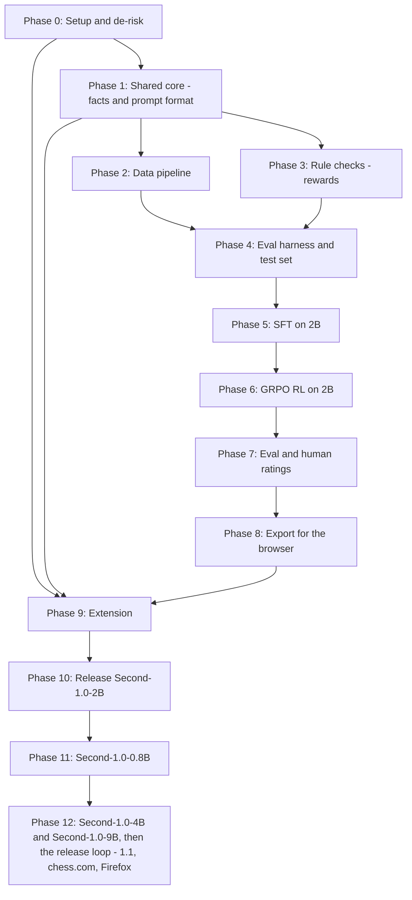
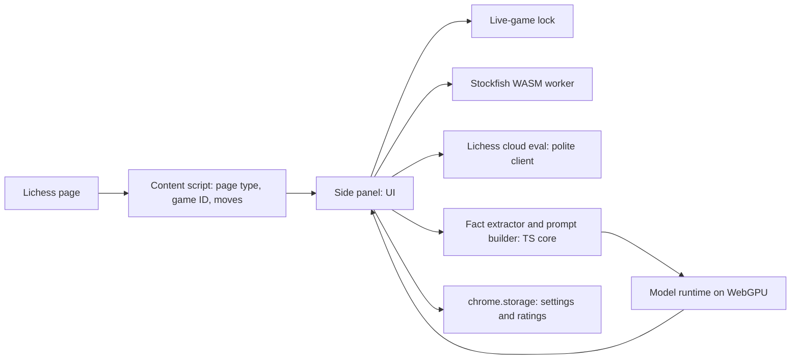
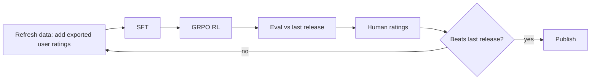

# Second — Full Project Plan

**Second** is an open-source line of small language models that explain chess clearly. It is based on Qwen 3.5. It comes with a browser extension that runs the model fully on the user's GPU (WebGPU) on Lichess.

> [!IMPORTANT]
> This plan uses **ordered phases only**. It has no dates. Do each phase after the phases it depends on.

---

## 0. Decisions summary

| Area | Decision |
|---|---|
| Core job | Turn engine facts into clear human explanations. Stockfish supplies the truth. The model does not calculate. |
| Tasks | (1) Explain one move. (2) Explain one position. (3) Review a game = task 1 run on the key moments. One model does all of them. |
| Levels | `beginner` (under ~1200) and `club` (~1200–2000). |
| Language | English only. |
| Output | Short prose, 2–4 sentences, ≤ ~80 words. A "more detail" mode gives a longer answer. |
| Base | Qwen 3.5 **instruct**, **non-thinking** mode, text only. |
| Model order | 2B → 0.8B → 4B → 9B. No 27B. |
| Data | Filtered human commentary only. No synthetic data. |
| Training | LoRA SFT warm-up, then GRPO RL. |
| RL reward | Rule checks only. No LLM judge inside the RL loop. |
| Eval | Fixed test set. Gemini Flash judges the test set (small API cost is OK). Blind A/B human ratings. |
| Baselines | Base Qwen 3.5 (same size), Gemini Flash, chess.com coach (human ratings only). |
| Budget | \$0 extra, except: small Gemini API cost for eval, and the \$5 Chrome Web Store fee. Compute = 200 Colab units per month. |
| Extension | Chrome + Edge, Manifest V3, Side Panel UI, Lichess first. |
| Engine in extension | Stockfish WASM locally + Lichess cloud eval, with polite use of the API. |
| Fair play | Works only after a game ends. Fail closed: if the status is unclear, it stays off. |
| Buttons | "Explain this move" and "Review game". |
| No WebGPU | Show a clear message. 0.8B is the fallback for weak GPUs. |
| Privacy | No telemetry. Thumbs up/down ratings stay local. The user can export them. |
| Open source | Models, data, training code, and reward code: Apache 2.0. The **extension**: GPLv3, because it bundles Stockfish (GPLv3). Everything is published. Unclear-license data: train on it, publish only the rebuild script. |
| Hosting | GitHub (code). Hugging Face (weights, datasets, demo, rating site). |
| Stores | Chrome Web Store (\$5 once) + Edge Add-ons (free). |
| Model names | `Second-<version>-<size>`. Version 1.0 covers all four sizes: `Second-1.0-2B`, `Second-1.0-0.8B`, `Second-1.0-4B`, `Second-1.0-9B`. One version = one recipe (data, rewards, training method, base model family). A recipe change bumps the version: `Second-1.1-2B`, … |
| Release rule | A new version of a size ships only if it beats the previous version of that size on the test set. |

---

## 1. Phase overview



> [!TIP]
> You can build Phase 9 (the extension) in parallel with Phases 2–8. To do this, use the **base** Qwen 3.5 2B model as a stand-in. Swap in the trained model when Phase 8 is done.

---

## 2. Phase 0 — Setup and de-risk

Goal: prove that the risky parts work **before** you spend compute on training.

### 0.1 Repo and accounts
1. Create the GitHub repo `second` (public). Add an Apache 2.0 `LICENSE` and a short `README.md`.
2. Make the folder layout from [section 15](#15-repo-layout).
3. Create a Hugging Face account or organization (for example `second-chess`).
4. Get a free Gemini API key from Google AI Studio. Store it as a Colab secret (`GEMINI_API_KEY`). Never commit it.
5. Make a Google Drive folder `second/` for checkpoints. Colab sessions stop after a maximum of about 12 hours, and work that is not saved is lost.

### 0.2 Browser runtime test (the biggest risk)
Qwen 3.5 uses a hybrid attention design (Gated DeltaNet + standard attention). Browser support for it is new.

1. Make a small test web page in `spikes/browser-runtime/`.
2. Load the **base** Qwen 3.5 2B instruct (q4) in each runtime:
   - **Transformers.js** (ONNX Runtime Web, WebGPU)
   - **WebLLM** (MLC)
   - **wllama** (GGUF)
3. Use one fixed test prompt of about 400 tokens. This is the size of a real Second prompt. Record these numbers for each runtime:
   - Does it load and give correct text? (Compare with the Python output for the same prompt and greedy decoding.)
   - Download size.
   - Time to first token.
   - Tokens per second.
   - Peak GPU memory, if visible.
   - Does it run in a Chrome extension page? (Test in a minimal MV3 extension, not only a normal web page.)
4. Test on at least: one laptop with integrated graphics, one laptop or desktop with a dedicated GPU, and one Mac, if you can get one.
5. Repeat for the 0.8B model.
6. **Choose one runtime.** Write the result to `docs/decisions/runtime.md`.

**Pass rule:** at least ~15 tokens per second on a mid-range laptop for 2B, and correct output.
**If no runtime passes:** stop and choose again. Options: wait for runtime support, use 0.8B as the main browser model, or use a different base model that runtimes support. Do not start training before this is solved.

### 0.3 Training stack test
1. Open a Colab notebook on an **L4** GPU.
2. Install Unsloth (or TRL if Unsloth does not support Qwen 3.5 yet). Install the fast kernels that the hybrid attention needs (for example `flash-linear-attention` and `causal-conv1d`, if required).
3. Load Qwen 3.5 2B instruct with LoRA.
4. Run **10 steps of SFT** on dummy data.
5. Run **10 steps of GRPO** with a dummy reward (for example, "reward = 1 if the output is under 50 words").
6. Check whether fast generation (vLLM) works for Qwen 3.5 in GRPO. If it does not, GRPO is much slower. Record this, because it changes the compute estimates.
7. Save a checkpoint to Drive. Then stop the runtime, start a new one, and resume from the checkpoint.
8. Record the compute units used per hour and the step times. Write them to `docs/decisions/compute.md`.

### 0.4 Stockfish in Colab
1. Install Stockfish (a recent version with NNUE) in Colab.
2. Install `python-chess`.
3. Analyse 100 positions at a fixed depth (start with depth 18). Measure the time. You need this to plan the data pipeline.

### 0.5 License check of data sources
For each source, write the license and the decision to `docs/data_sources.md`:

| Source | Likely status | Plan |
|---|---|---|
| Lichess game database | CC0 | Publish freely. |
| Lichess puzzles | CC0 | Publish freely. |
| Lichess studies | Check terms per study | Use only studies with clear terms. Otherwise use a rebuild script only. |
| GameKnot commentary | Unclear | Train on it. Publish only the rebuild script. |
| MATE dataset | Check its license | Follow its license. |

> [!NOTE]
> This is not legal advice. Check each license yourself before you publish.

**Phase 0 is done when:** one browser runtime is chosen, SFT and GRPO both run on 2B in Colab, resuming from a checkpoint works, and every data source has a license decision.

---

## 3. Phase 1 — Shared core: facts and prompt format

Goal: one exact input format. Training (Python) and the extension (TypeScript) must build **the same text, byte for byte**. If they differ, the model performs worse in the browser.

### 1.1 Fact extractor
Code that reads a position and engine output and writes facts. Write it twice:
- Python, with `python-chess`, in `core/python/`.
- TypeScript, with `chessops` (the Lichess chess library), in `core/ts/`.

Facts to compute:

| Fact | Example text |
|---|---|
| Side to move, move number | `White to move, move 14.` |
| Move played (SAN) | `Move played: Nxe5.` |
| Verdict | `Verdict: Mistake.` |
| Win chance before → after | `White's winning chances: 62% → 41%.` |
| Best move | `Best move: Bd3.` |
| Best line (first 4–6 plies) | `Best line: Bd3 O-O Qc2 h6.` |
| Opponent's best reply to the played move | `After Nxe5, Black's best reply is Qa5+.` |
| Material balance | `Material: equal.` / `White is up a knight.` |
| Material change in the next few plies of the line | `After Qa5+, Black wins the knight on e5.` |
| Hanging pieces | `The knight on e5 is not defended.` |
| Checks and captures available | `Black has a check: Qa5+.` |
| Threats (what the side to move threatens if it could move again) | `White threatens Bxh7+.` |
| King safety (simple) | `Black has not castled.` |
| Game phase | `Phase: middlegame.` |
| Opening name (if in the book) | `Opening: Italian Game.` |

**Verdict rules:** use the Lichess win-chance formula and the Lichess classes (Inaccuracy / Mistake / Blunder), so that verdicts match what users see on Lichess. Add `Best` and `Good` for moves with no drop. Add `Only move` when every other move loses a lot.

**Rule:** facts use fixed sentence templates. No numbers except win chances, and only in the facts. The model is trained **not** to repeat numbers to beginners.

### 1.2 Prompt format (the "contract")
Use the Qwen chat template. The system message is fixed. The user message has this shape:

```text
task: explain_move
level: club
detail: short

FEN: r1bqkb1r/pppp1ppp/2n2n2/4p3/2B1P3/5N2/PPPP1PPP/RNBQK2R w KQkq - 4 4
White to move, move 4.
Move played: Ng5.
Verdict: Good.
White's winning chances: 54% → 53%.
Best move: d3.
Best line: d3 Bc5 c3 d6.
Facts:
- Ng5 attacks the pawn on f7 together with the bishop on c4.
- Black's best reply is d5.
- Material: equal.
- Phase: opening.
- Opening: Italian Game, Two Knights Defense.
```

- `task`: `explain_move`, `explain_position`.
- `level`: `beginner`, `club`.
- `detail`: `short`, `long`.
- `explain_position` has no "Move played" or "Verdict" lines. Instead it lists the best moves for the side to move and the main facts.

"Review game" is **not** a separate model task in 1.0. The extension finds the key moments (Inaccuracy or worse, plus the single biggest swing). It then runs `explain_move` on each one and shows them as a list.

### 1.3 Parity tests (golden files)
1. Make `core/golden/`: 200 positions + engine outputs (as JSON) + the expected prompt text.
2. The Python tests and the TypeScript tests must both produce **exactly** the expected text.
3. Run both in GitHub Actions on every push.

**Phase 1 is done when:** both implementations pass all golden tests.

---

## 4. Phase 2 — Data pipeline

Goal: clean training data from human commentary, plus prompts for RL.

> [!NOTE]
> RL does **not** need human text. It needs only positions, because the rule checks score the output. So RL prompts can come from the CC0 Lichess game database in unlimited numbers.

### 2.1 Collect raw data
Scripts in `data/sources/`, one per source:
1. `gameknot.py`: download and parse into (PGN up to the move, move, comment). Do not publish the raw output.
2. `lichess_studies.py`: get the PGNs of studies that have commentary (only studies with clear terms), and extract (position, move, comment) from them.
3. `mate.py`: if the license allows it.
4. `lichess_games.py`: sample games from the Lichess open database for RL prompts. Mix of ratings, with a focus on 800–2000.

### 2.2 Analyse with Stockfish
1. For each (position, move): run Stockfish at a fixed depth, with MultiPV 3.
2. Run the fact extractor. Build the prompt with the Phase 1 code.
3. Cache the results by FEN in a Parquet file on Drive. Never analyse the same position twice.
4. Run this on Colab **CPU** runtimes where possible. CPU runtimes cost fewer units than GPU runtimes.

### 2.3 Filter human comments
Remove a comment if any of these is true:
- It has fewer than 8 words.
- It is not English (use a language detector).
- It has no chess content (no piece, square, move, or chess term).
- It names an illegal move or a wrong piece on a square. (Use the Phase 3 rule checks.)
- Its tone disagrees with the verdict. Example: "great move!" on a Blunder. (Use a small word list for positive and negative tone.)
- It is a duplicate or a near-duplicate.
- It contains links, usernames, or offensive words.

Then:
- Clean it: fix spacing, remove move numbers at the start, and remove annotation symbols like `!?` that stand alone.
- Cut comments that are too long down to the first 2–4 sentences, for `detail: short`. Keep longer comments of good quality as `detail: long` examples.

Record how many items each filter removes. Write this to the dataset card.

### 2.4 Level labels
Label each kept comment:
- `beginner`: average sentence length ≤ 15 words, and no words from the jargon list (for example "prophylaxis", "zwischenzug", "outpost", "minority attack", "centipawn").
- `club`: all other comments.

If there are too few beginner examples, accept this for SFT. RL will push the beginner style through the rule checks.

### 2.5 Splits
- Split by **game**, not by position. Positions from one game must not be in both train and test.
- `train` / `val` (~2%) / `test` pool.
- The test set (Phase 4) comes from the test pool.

### 2.6 RL prompt set
- 20k–50k prompts from Lichess games (CC0).
- Mix: ~45% moves that are Inaccuracy or worse, ~35% Good or Best moves, ~20% `explain_position`.
- Levels: 50/50 beginner and club. Detail: 80% short, 20% long.

### 2.7 Publish
- Hugging Face dataset `second-chess/second-data-1.0`:
  - Publish in full: the CC0 parts, the RL prompts, and the clean-license human data.
  - Publish only the rebuild scripts for unclear-license sources.
- Write a dataset card: the sources, the licenses, the filter counts, and the known limits.

**Phase 2 is done when:** the SFT set, the RL prompt set, and the test pool exist on Drive, and the counts are recorded.

---

## 5. Phase 3 — Rule checks (rewards)

Goal: one Python module, `rewards/`, that scores an explanation. RL uses it for rewards. Eval uses it for metrics. Each check returns a pass/fail flag and a reason. Unit tests cover every check.

### 3.1 Parsing
- Find move-like tokens with a SAN regex (`Nxf7`, `O-O`, `e8=Q`, `Qh5+`).
- Find square names (`e5`) and piece + square pairs ("the knight on e5", "the e5 knight").
- Find verdict words: "blunder", "mistake", "inaccuracy", "winning", "losing", "equal", "good move", "best move", and so on.

### 3.2 Hard checks (any fail → reward = −1)
| Check | Fails when |
|---|---|
| Legal moves | A named move is not legal in the position, and is not legal at its place in a line from the facts. |
| Grounded moves | A named move is not in the facts (played move, best move, best line, replies, threats). |
| Piece on square | "the knight on e5", but there is no knight on e5 (in the position or after the played move). |
| Verdict tone | Positive words for an Inaccuracy, Mistake, or Blunder. Negative words for a Best or Good move. |
| Format | Markdown, lists, or headings in the output. Text that is not English. Repeats the prompt. |
| Engine jargon for beginners | `level: beginner` and the text has "centipawn", "eval", "+1.3", "depth", "engine", or numbers with decimals. |

### 3.3 Soft scores (each 0–1, weighted sum)
| Score | Weight | Gives 1 when |
|---|---|---|
| Key point | 0.35 | The text names the most important fact. Mistakes: the threat or the lost material, and the better move. Good moves: the main idea. |
| Better move | 0.15 | For Mistakes and Blunders, the text names the best move or its idea. (For Good or Best moves, this score is always 1.) |
| Length | 0.15 | Short: 25–80 words. Long: 80–200 words. The score falls off smoothly outside the band. |
| Level fit | 0.15 | Beginner: short sentences, no jargon. Club: jargon is allowed but not required. |
| Not copied | 0.10 | Low n-gram overlap with the fact lines. The model must explain, not repeat the facts. |
| No repeats | 0.10 | No repeated sentences or phrases. |

**Reward = −1** if any hard check fails. **Otherwise reward = the weighted sum** (0 to 1).

### 3.4 Anti-hacking guards
RL finds loopholes. Plan for this:
- Limit the key-point score so that naming *all* facts gives no extra reward.
- The "not copied" score stops the model from pasting the facts.
- Read 20 random outputs by hand every ~50 RL steps. If the model finds a trick, add a check and restart from the last good checkpoint.
- Keep the test-set judge (Gemini) separate from the RL reward. If the RL reward goes up but the judge score goes down, the model is hacking the reward.

### 3.5 Test the checks on human data
Run the checks on 500 filtered human comments. Read the failures. Fix the false alarms. A good human comment should get a reward of ~0.6 or more.

**Phase 3 is done when:** all unit tests pass, and good human comments score as expected.

---

## 6. Phase 4 — Eval harness and test set

### 4.1 Test set (frozen)
- **300 items** from the test pool, chosen by hand where needed.
- Mix: 120 Inaccuracy or worse, 90 Good or Best, 45 `explain_position`, 45 `detail: long`.
- Levels: half beginner, half club.
- Ratings: 800–2000, all game phases.
- Save it as `eval/testset-1.0.jsonl`. **Never train on it.** Never change it within a version. Make a new test set file only for a new major version.

### 4.2 Automatic metrics (free)
For every model on the test set (greedy decoding):
- **Hard-fail rate:** % of outputs with any hard check fail. This is the main hallucination metric.
- **Mean reward.**
- **Verdict accuracy.**
- **Average length, and % of outputs in the length band.**

### 4.3 Gemini judge (small API cost)
- Model: Gemini Flash (the current version).
- **Pairwise, blind:** the judge gets the prompt (with the facts) and two explanations in random A/B order. It picks the better one for a player at the given level, based on correctness, clarity, and usefulness. Run every pair twice with A and B swapped. If the two picks disagree, count a tie.
- **Rubric score:** 1–5 each for correctness, clarity, usefulness, and level fit.
- Comparisons per model: vs base Qwen (same size), vs Gemini Flash's own explanations, and vs the last Second release.
- Cost: ~300 items × 2 orders × 3 opponents ≈ 1,800 short calls per model. Use the free tier first. Pay only if the free tier is too slow.
- Store all judge outputs in `eval/results/`.

### 4.4 Baseline outputs
Generate the explanations of base Qwen 3.5 (each size) and Gemini Flash once, with the same prompts. Store them.

### 4.5 Human rating site
- A Hugging Face Space (Gradio, free).
- It shows the board, the move, and two explanations, A and B, in random order. The rater picks A, B, or "same".
- The votes go to a private HF dataset.
- Sets: Second vs base Qwen, Second vs Gemini Flash, Second vs chess.com coach.
- **Chess.com coach set:** analyse ~30 of your own games with chess.com Game Review. Copy the coach text by hand for 30 positions. Use these **only** for private rating. **Do not publish** the chess.com text.
- Recruit raters on r/chess, the Lichess forum, chess Discord servers, and local clubs. Target: 5–10 raters, ~50 votes each.

**Phase 4 is done when:** one command produces a full report (automatic metrics + judge results) for any model checkpoint.

---

## 7. Phase 5 — SFT on 2B

| Setting | Start value |
|---|---|
| Base | Qwen 3.5 2B instruct, text only, non-thinking |
| Method | LoRA (rank 32, alpha 32, all linear layers) |
| Data | Filtered human SFT set. Use up to ~20k examples. More is not better if the quality drops. |
| Epochs | 1–2 |
| Learning rate | 1e-4, cosine schedule, 3% warm-up |
| Max sequence length | 1,024 tokens |
| Loss | On the answer tokens only |
| GPU | L4 |

Steps:
1. Train. Save a checkpoint to Drive every ~200 steps.
2. Run the Phase 4 automatic metrics on the `val` split and the test set.
3. Read 30 outputs by hand.
4. **Pass rule:** the format is correct in more than 95% of outputs, and the hard-fail rate is lower than base Qwen's.

> [!NOTE]
> Human comments do not use the facts directly. Expect the SFT model to learn the voice and the format, but still make some factual errors. RL fixes the facts.

---

## 8. Phase 6 — GRPO RL on 2B

| Setting | Start value |
|---|---|
| Start from | The Phase 5 SFT checkpoint (LoRA) |
| Algorithm | GRPO (Unsloth or TRL) |
| Prompts | The Phase 2 RL prompt set |
| Generations per prompt | 8 |
| Max answer length | 300 tokens (long mode needs room) |
| Temperature | 0.9 |
| Learning rate | 5e-6 |
| KL beta | 0.02 (try 0 if learning is too slow) |
| Steps | 300–600, stop early when the val reward stops going up |
| Reward | The Phase 3 reward function |
| GPU | L4 (A100 if L4 is too slow) |

Steps:
1. Run 50 steps. Check that the reward goes up and the output still looks normal.
2. Continue. Save checkpoints to Drive every 25–50 steps.
3. Every ~50 steps: log the mean reward, the hard-fail rate, and the average length. Read 20 outputs by hand (section 3.4).
4. At the best checkpoints, run the Phase 4 automatic metrics. Keep the best 2–3 checkpoints.
5. Run the Gemini judge on the best checkpoint only. This saves API calls.

**Watch for:**
- Length collapse: the model writes the shortest possible text. Fix: tune the length score.
- Robotic text: every answer starts the same way. Fix: add a check for repeated openings, or add a small local judge later.
- Reward hacking: see section 3.4.

> [!NOTE]
> **Phase 6 Completed (2026-11-06)**:
> - Model trained for 450 steps on NVIDIA L4 GPU. Best checkpoint selected: `checkpoint-300`.
> - Test mean reward reached **0.5428** (vs **0.4772** SFT baseline).
> - Test hard-fail rate decreased to **7.7%** (vs **11.3%** SFT baseline and **100.0%** base Qwen 2B).
> - Test format pass rate reached **100.0%** (>95.0% required).
> - Full Gemini 3.5 Flash Lite judge evaluated on all 300 test items across 3 opponents. Head-to-head vs SFT: GRPO won 53, lost 50, tied 197 (83.3% win+tie rate).
> - Anti-hacking audit and 20 sample reviews documented in [grpo-1.0-2b.md](eval/reports/grpo-1.0-2b.md).

---

## 9. Phase 7 — Eval and human ratings for 2B

1. Run the full Phase 4 report on the chosen checkpoint.
2. Run the human rating site for all three sets.
3. **Release rule for 1.0:**
   - The hard-fail rate is clearly lower than base Qwen 2B's.
   - The judge prefers Second over base Qwen 2B in most pairs.
   - Human raters prefer Second over the chess.com coach in at least half of the pairs. This is your main goal.
   - Beating Gemini Flash is **not** required. Report the result honestly.
4. Write `eval/reports/Second-1.0-2B.md` with all numbers and 10 example outputs (good and bad).

If the release rule fails: find the weak area from the report (data, reward, or prompt). Fix it. Go back to Phase 5 or 6.

---

## 10. Phase 8 — Export for the browser

1. Merge the LoRA into the base weights. Save in safetensors format.
2. Remove the vision parts of the model if the runtime allows it. Second uses text only, so this makes the download smaller.
3. Convert the model for the runtime you chose in Phase 0:
   - Transformers.js → ONNX, q4 (q4f16 if supported).
   - WebLLM → MLC compile, q4f16.
   - wllama → GGUF, Q4_K_M.
4. **Quality check after the conversion:** run 100 test prompts in the browser with greedy decoding. Compare them with the Python outputs. The hard-fail rate must be at most ~2 points worse. If it is worse, try a less aggressive quantization.
5. Upload to Hugging Face: `second-chess/Second-1.0-2B` (full weights) and `second-chess/Second-1.0-2B-web` (browser files).
6. Write the model card: what the model does, what it does not do, the input format, the eval results, the limits, the license, and the fair-play note.

---

## 11. Phase 9 — Browser extension

### 9.1 Architecture



- **Manifest V3.** Permissions: `sidePanel`, `storage`, `unlimitedStorage`. Host permissions: `lichess.org` and `huggingface.co` (for the model download).
- **The model runs in the side panel page.** The model stays loaded while the panel is open. This is simple and reliable. Phase 0 already tested that WebGPU works in an extension page.
- **Code:** TypeScript + Vite. Use a small UI framework (for example Preact or Svelte) or plain TS.

### 9.2 Content script (Lichess)
1. Detect the page type from the URL and the page: analysis board, study, finished game, live game, puzzle, or other.
2. Read the game ID, the current position (FEN), and the move list.
3. Prefer the Lichess API for the move list, because the page layout can change. Use the page as a fallback.
4. Send updates to the side panel.

### 9.3 Live-game lock (fail closed)
- **Allowed:** `/analysis`, `/study/...`, and game pages where the API says the game has ended.
- For a game page: call `GET https://lichess.org/game/export/{id}` and read the status. If the game is still running, or the request fails, or the status is unclear → **off**.
- **Off** on puzzle, storm, and racer pages, and on all other pages.
- When it is off, the panel shows: "Second is off during live games. Open the game after it ends."
- Unit tests for every page type. This module must have the most tests in the extension.

### 9.4 Engine
1. **Stockfish WASM** (the Lichess build or a recent `stockfish.js`) in a Web Worker.
   - Multi-threaded Stockfish needs `SharedArrayBuffer`. Set the cross-origin isolation headers in the manifest. Fall back to single-threaded if this fails.
   - Default: depth 18 or 2 seconds per position, whichever comes first. MultiPV 3.
2. **Cloud eval client** (polite use):
   - Only after a user click.
   - Only one request at a time.
   - Cache the results by FEN.
   - On HTTP 429: stop all cloud requests for at least 60 seconds.
   - A settings switch turns it off. The default is on.
   - If cloud eval has no data for the position → use local Stockfish.

### 9.5 Model loading
1. Check for WebGPU (`navigator.gpu`, an adapter, and the needed features).
2. No WebGPU → show: "Your browser or device does not support WebGPU. Second cannot run here." Add a help link.
3. Weak GPU (detected from adapter limits, or the user picks it) → offer 0.8B (after Phase 11).
4. First use: "Second needs to download its model (about 1.2 GB). The model runs on your device. Download now?"
5. Show a progress bar. Store the files in the browser cache. Check the files on load.
6. A settings button deletes the model files.

### 9.6 Features
- **Explain this move:** the move on screen → engine → facts → prompt → model → text appears word by word (streaming).
- **Review game:** analyse every move with local Stockfish (with a progress bar). Find the key moments. Explain each one. Show a clickable list. A click jumps to that move on the Lichess board, if possible, or shows a small board in the panel.
- **More detail:** reruns with `detail: long`.
- **Settings:** level (beginner/club), model (2B/0.8B), cloud eval on/off, delete model.
- **Ratings:** a thumbs up/down under each explanation. Saved in `chrome.storage.local` with the prompt and the output. An "Export ratings" button saves a JSON file.

### 9.7 Testing
- Unit tests: the lock, the parsers, the prompt builder (the golden files from Phase 1), the cloud eval limiter.
- Manual test list in `extension/TESTING.md`: each page type, live game (must be off), no WebGPU, cancelled download, 429 from Lichess, closing the panel while the model writes.

### 9.8 Store needs
- A privacy policy page (GitHub Pages): "No data leaves your device except: the model download from Hugging Face, and position requests to the Lichess cloud eval if this is switched on."
- Store screenshots, a short description, and an icon.
- A fair-play note in the description: "Second works only after a game ends."

---

## 12. Phase 10 — Release Second-1.0-2B

1. Final eval report published (`eval/reports/Second-1.0-2B.md`).
2. Hugging Face: model, web model, dataset, model card, dataset card.
3. A Hugging Face demo Space: paste a PGN or FEN, pick a move, get an explanation (runs on the free CPU tier, or WebGPU in the visitor's browser).
4. GitHub release `v1.0.0`, with release notes.
5. Chrome Web Store: pay the \$5 fee once. Submit the extension. (The review can take some days.)
6. Edge Add-ons: submit (free).
7. Announce it: r/chess, the Lichess forum, the Hugging Face community. Ask people for exported ratings.

---

## 13. Phase 11 — Second-1.0-0.8B

The same recipe (data, rewards, settings) on Qwen 3.5 0.8B. So it is also version **1.0**.

1. SFT (Phase 5 settings; try learning rate 2e-4).
2. GRPO (Phase 6 settings).
3. Eval. Release rule: better than base Qwen 0.8B. Report the gap to Second-1.0-2B.
4. Export, then test in the browser on weak devices.
5. Turn on the extension's 0.8B option and the "weak GPU" suggestion.
6. Release on Hugging Face. Update the extension.

---

## 14. Phase 12 — The release loop

Each new release runs the same loop:



### Version rule
- One version = one recipe: the same data, rewards, training method, and base model family.
- **The 1.0 recipe is frozen when Second-1.0-2B ships.** For larger sizes, only size-specific settings can change: learning rate, batch size, LoRA rank, and GPU type. Record these in `training/configs/`.
- Any other change (new data, new reward checks, a new base model, and so on) bumps the version to 1.1. Then all sizes are retrained over time.

### Order of the next releases
1. **Second-1.0-4B:** the 1.0 recipe on Qwen 3.5 4B. Release rule: better than base Qwen 4B and better than Second-1.0-2B. Test it in the browser. If it runs well on good GPUs, add it to the extension as a third model option.
2. **Second-1.0-9B:** the 1.0 recipe on Qwen 3.5 9B. It needs an A100 for GRPO. Expect one RL run to use most of a month's units. Split the run over several sessions and resume from checkpoints. Release it on Hugging Face. 9B is probably too big for most browsers, so it may stay a download-only model for local tools.
3. **Second-1.1** (all sizes, starting with 2B): collect the recipe changes in `docs/changes-1.1.md` while 1.0 ships. Typical changes: use the exported ratings (good-rated outputs become new SFT data, and bad-rated ones become new test items and new rule checks), plus fixes for the weak areas from the 1.0 eval reports. Retrain in the same order: 2B → 0.8B → 4B → 9B.
4. **Extension:** add chess.com support (DOM reading, with the same fail-closed lock rules), then Firefox. These can happen at any point after Phase 10.
5. **Later ideas, not planned:** a model-written game summary, more levels, more languages, a small local judge in RL, board highlights.

---

## 15. Repo layout

```text
second/
├── LICENSE                  # Apache 2.0 (everything except extension/)
├── README.md
├── docs/
│   ├── decisions/           # runtime.md, compute.md, ...
│   ├── data_sources.md
│   └── prompt_format.md     # The input contract
├── core/
│   ├── python/              # Fact extractor + prompt builder (python-chess)
│   ├── ts/                  # The same in TypeScript (chessops)
│   └── golden/              # Parity test files
├── data/
│   ├── sources/             # One script per source
│   ├── pipeline/            # Analyse, filter, label, split
│   └── cards/               # Dataset cards
├── rewards/                 # Rule checks (used by RL and eval)
├── training/
│   ├── sft.ipynb
│   ├── grpo.ipynb
│   └── configs/             # One YAML file per model size and version
├── eval/
│   ├── testset-1.0.jsonl
│   ├── run_eval.py
│   ├── judge.py
│   ├── rating_space/        # Gradio app for the human ratings
│   ├── results/
│   └── reports/
├── export/                  # Merge, convert, browser check
├── extension/
│   ├── LICENSE              # GPLv3 (bundles Stockfish)
│   ├── src/
│   ├── public/
│   ├── manifest.json
│   └── TESTING.md
├── spikes/                  # Phase 0 experiments
└── .github/workflows/       # Tests for Python, TS, golden parity
```

---

## 16. Compute budget (estimates)

> [!NOTE]
> Updated after Phase 0.3 with empirical benchmarks on NVIDIA L4 GPU.

Assumed rates: L4 ≈ 2.5 units per hour, A100 ≈ 6–12 units per hour.

| Job | GPU / Hardware | Hours | Units | Status |
|---|---|---|---|---|
| Phase 0 tests | L4 (Colab) | 0.5 | 1.2 | Verified |
| Stockfish analysis | Local CPU (4 threads) | 1.48 | 0 | Verified |
| SFT 2B (1,000 steps) | L4 (Colab) | 0.31 | 0.8 | Verified |
| GRPO 2B (500 steps) | L4 (Colab) | 1.65 | 4.1 | Verified |
| Eval runs (several) | L4 (Colab) | 1.50 | 3.8 | Projected |
| **Second-1.0-2B training + eval (GPU)** | L4 (Colab) | **3.46** | **8.7** | **Within 200 unit monthly budget** |
| **All Phase 0–7 jobs (GPU + CPU)** | | **5.44** | **9.9** | **Within 200 unit monthly budget** |
| 0.8B (SFT + GRPO) | L4 (Colab) | ~1.0 | ~2.5 | Projected |
| 4B (SFT + GRPO) | L4 or A100 | ~6–10 | ~20–35 | Projected |
| 9B (SFT + GRPO) | A100 | ~15–20 | ~90–150 | Projected |

**Colab rules for every run:**
- Save checkpoints to Drive often.
- Every notebook can resume from the last checkpoint.
- Stop the runtime when a run ends. Idle runtimes still use units.
- Run data and CPU jobs on CPU runtimes.

---

## 17. Risks

| Risk | Effect | What we do |
|---|---|---|
| No browser runtime runs Qwen 3.5 well | No extension | Phase 0 test before training. Fallbacks: 0.8B, wait for support, or another base model. |
| Unsloth or vLLM does not support Qwen 3.5 GRPO well | Slow or expensive RL | Phase 0.3 test. Fall back to plain TRL with shorter outputs. |
| Too little clean human data | Weak SFT | Accept it. RL does the main work. Use exported ratings in 1.1. |
| Reward hacking | Strange text with a high reward | Section 3.4 guards. Read outputs by hand. Use the judge as a separate check. |
| Robotic or repetitive text | Users dislike it | Repetition checks. Add a local judge in a later release. |
| Quantization hurts quality | Worse in the browser than in tests | Phase 8 quality check. Use a less aggressive quantization. |
| Python and TS prompts differ | Worse in the browser | Golden parity tests in CI. |
| Lichess changes its pages | Extension breaks | Use the API first. The lock fails closed. |
| Extension used to cheat | Bans, bad name for the project | Fail-closed lock. Fair-play note. Lichess only, after a game ends. |
| Store rejects the extension | No easy install | Clear privacy policy, minimal permissions, GitHub install guide as a backup. |
| License problems with data | Takedown requests | Publish only the scripts for unclear sources. |

---

## 18. Late decisions (settled)

These two points came up while the plan was written. Both are now decided.

1. **Extension license: GPLv3.** The extension bundles Stockfish, which is GPLv3. So the `extension/` folder uses GPLv3. Models, data, training code, and reward code stay Apache 2.0.
2. **Version scheme: one version = one recipe.** All four sizes ship as 1.0 first (2B → 0.8B → 4B → 9B). A change to the data, the rewards, the training method, or the base model bumps the version to 1.1. See the version rule in [Phase 12](#14-phase-12--the-release-loop).
