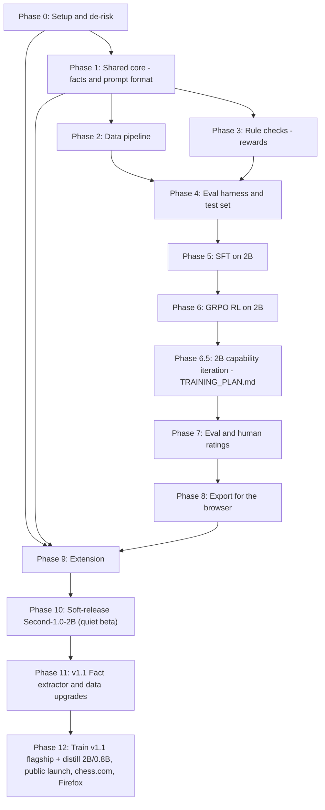
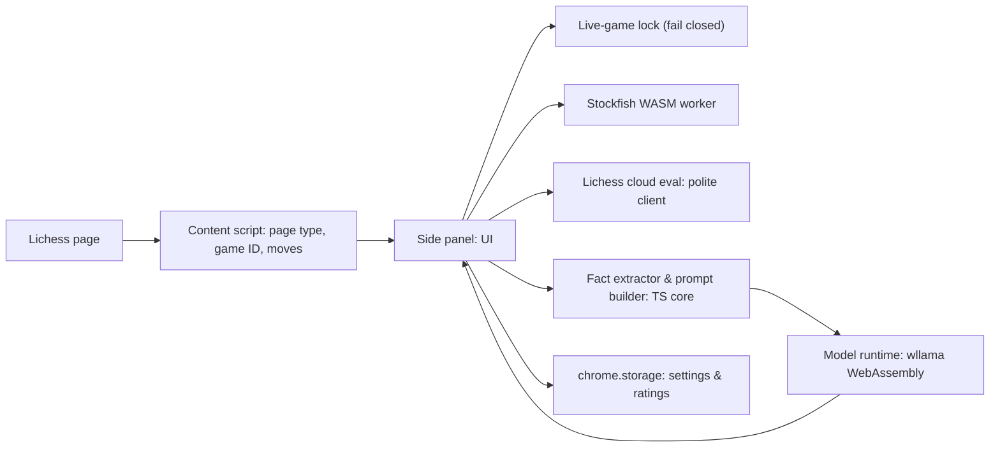
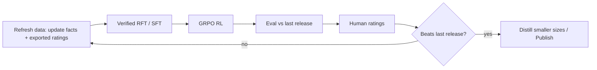

# Second — Full Project Plan

**Second** is an open-source line of small language models that explain chess clearly. It is based on Qwen 3.5. It comes with a browser extension that runs the model fully on the user's GPU (WebGPU) on Lichess.

> [!IMPORTANT]
> This plan uses **ordered phases only**. It has no dates. Do each phase after the phases it depends on.

---

## 0. Decisions summary

| Area | Decision |
|---|---|
| Core job | Turn engine facts into clear human explanations. Stockfish supplies the truth. The model does not calculate. |
| Tasks | (1) Explain one move. (2) Explain one position. (3) Review a game = task 1 run on the key moments. One model does all of them. |
| Levels | `beginner` (under ~1200) and `club` (~1200–2000). |
| Language | English only. |
| Output | Short prose, 2–4 sentences, ≤ ~80 words. A "more detail" mode gives a longer answer. |
| Base | Qwen 3.5 **instruct**, text only. `v1.0` uses **Fast** (`non-thinking`) mode only. Thinking mode was removed from the extension. |
| Model order | `v1.0`: `2B` only (soft release). `v1.1`: train the flagship (`27B` or `9B`) first, then distill smaller browser models (`2B`, `0.8B`, `4B`). |
| Data | Filtered human commentary + engine-grounded synthetic explanations from Apache 2.0 open-weight models or verified self-training (`RFT`), checked by rule checks. |
| Training | LoRA (or full-parameter) SFT warm-up, then token-level GRPO RL (DAPO / GDPO) with graded rewards and multiplicative length rescaling. |
| RL reward | Rule checks only. No LLM judge inside the RL loop. |
| Eval | Fixed test set + separate dev set (`eval/devset-1.0.jsonl`). Debiased Gemini Flash judge + Length-Controlled Win Rate (LC-WR) + 60-item calibration set. Blind A/B human ratings. |
| Baselines | Base Qwen 3.5 (same size), Gemini Flash, chess.com coach (human ratings only). |
| Budget | \$0 extra, except: small Gemini API cost for eval, and the \$5 Chrome Web Store fee. Compute = 200 Colab units per month. |
| Extension | Chrome + Edge, Manifest V3, Side Panel UI, Lichess first. |
| Engine in extension | Stockfish WASM locally + Lichess cloud eval, with polite use of the API. |
| Fair play | Works only after a game ends. Fail closed: if the status is unclear, it stays off. |
| Buttons | "Explain this move" and "Review game". (Thinking switch removed.) |
| No WebGPU | Show a clear message. `0.8B` is planned for `v1.1` as the fallback for weak GPUs. |
| Privacy | No telemetry. Thumbs up/down ratings stay local. The user can export them. |
| Open source | Models, data, training code, and reward code: Apache 2.0. The **extension**: GPLv3, because it bundles Stockfish (GPLv3). Everything is published. Unclear-license data: train on it, publish only the rebuild script. |
| Hosting | GitHub (code). Hugging Face (weights, datasets, demo, rating site). |
| Stores | Chrome Web Store (\$5 once). Edge Add-ons skipped; Edge users install from the Chrome Web Store. |
| Model names | `Second-<version>-<size>`. Version 1.0 ships `Second-1.0-2B` only. Changes to facts, data, or rewards move to `Second-1.1-*`. |
| Release rule | A new version of a size ships only if it beats the previous version of that size on the test set. |

---

## 1. Phase overview



> [!TIP]
> You can build Phase 9 (the extension) in parallel with Phases 2–8. To do this, use the **base** Qwen 3.5 2B model as a stand-in. Swap in the trained model when Phase 8 is done.

---

## 2. Phase 0 — Setup and de-risk

Goal: prove that the risky parts work **before** you spend compute on training.

### 0.1 Repo and accounts
1. Create the GitHub repo `second` (public). Add an Apache 2.0 `LICENSE` and a short `README.md`.
2. Make the folder layout from [section 15](#15-repo-layout).
3. Create a Hugging Face account or organization (for example `second-chess`).
4. Get a free Gemini API key from Google AI Studio. Store it as a Colab secret (`GEMINI_API_KEY`). Never commit it.
5. Make a Google Drive folder `second/` for checkpoints. Colab sessions stop after a maximum of about 12 hours, and work that is not saved is lost.

### 0.2 Browser runtime test (the biggest risk)
Qwen 3.5 uses a hybrid attention design (Gated DeltaNet + standard attention). Browser support for it is new.

1. Make a small test web page in `spikes/browser-runtime/`.
2. Load the **base** Qwen 3.5 2B instruct (q4) in each runtime:
   - **Transformers.js** (ONNX Runtime Web, WebGPU)
   - **WebLLM** (MLC)
   - **wllama** (GGUF)
3. Use one fixed test prompt of about 400 tokens. This is the size of a real Second prompt. Record these numbers for each runtime:
   - Does it load and give correct text? (Compare with the Python output for the same prompt and greedy decoding.)
   - Download size.
   - Time to first token.
   - Tokens per second.
   - Peak GPU memory, if visible.
   - Does it run in a Chrome extension page? (Test in a minimal MV3 extension, not only a normal web page.)
4. Test on at least: one laptop with integrated graphics, one laptop or desktop with a dedicated GPU, and one Mac, if you can get one.
5. Repeat for the 0.8B model.
6. **Choose one runtime.** Write the result to `docs/decisions/runtime.md`.

**Pass rule:** at least ~15 tokens per second on a mid-range laptop for 2B, and correct output.
**If no runtime passes:** stop and choose again. Options: wait for runtime support, use 0.8B as the main browser model, or use a different base model that runtimes support. Do not start training before this is solved.

### 0.3 Training stack test
1. Open a Colab notebook on an **L4** GPU.
2. Install Unsloth (or TRL if Unsloth does not support Qwen 3.5 yet). Install the fast kernels that the hybrid attention needs (for example `flash-linear-attention` and `causal-conv1d`, if required).
3. Load Qwen 3.5 2B instruct with LoRA.
4. Run **10 steps of SFT** on dummy data.
5. Run **10 steps of GRPO** with a dummy reward (for example, "reward = 1 if the output is under 50 words").
6. Check whether fast generation (vLLM) works for Qwen 3.5 in GRPO. If it does not, GRPO is much slower. Record this, because it changes the compute estimates.
7. Save a checkpoint to Drive. Then stop the runtime, start a new one, and resume from the checkpoint.
8. Record the compute units used per hour and the step times. Write them to `docs/decisions/compute.md`.

### 0.4 Stockfish in Colab
1. Install Stockfish (a recent version with NNUE) in Colab.
2. Install `python-chess`.
3. Analyse 100 positions at a fixed depth (start with depth 18). Measure the time. You need this to plan the data pipeline.

### 0.5 License check of data sources
For each source, write the license and the decision to `docs/data_sources.md`:

| Source | Likely status | Plan |
|---|---|---|
| Lichess game database | CC0 | Publish freely. |
| Lichess puzzles | CC0 | Publish freely. |
| Lichess studies | Check terms per study | Use only studies with clear terms. Otherwise use a rebuild script only. |
| GameKnot commentary | Unclear | Train on it. Publish only the rebuild script. |
| MATE dataset | Check its license | Follow its license. |

> [!NOTE]
> This is not legal advice. Check each license yourself before you publish.

**Phase 0 is done when:** one browser runtime is chosen, SFT and GRPO both run on 2B in Colab, resuming from a checkpoint works, and every data source has a license decision.

---

## 3. Phase 1 — Shared core: facts and prompt format

Goal: one exact input format. Training (Python) and the extension (TypeScript) must build **the same text, byte for byte**. If they differ, the model performs worse in the browser.

### 1.1 Fact extractor
Code that reads a position and engine output and writes facts. Write it twice:
- Python, with `python-chess`, in `core/python/`.
- TypeScript, with `chessops` (the Lichess chess library), in `core/ts/`.

Facts to compute:

| Fact | Example text |
|---|---|
| Side to move, move number | `White to move, move 14.` |
| Move played (SAN) | `Move played: Nxe5.` |
| Verdict | `Verdict: Mistake.` |
| Win chance before → after | `White's winning chances: 62% → 41%.` |
| Best move | `Best move: Bd3.` |
| Best line (first 4–6 plies) | `Best line: Bd3 O-O Qc2 h6.` |
| Opponent's best reply to the played move | `After Nxe5, Black's best reply is Qa5+.` |
| Material balance | `Material: equal.` / `White is up a knight.` |
| Material change in the next few plies of the line | `After Qa5+, Black wins the knight on e5.` |
| Hanging pieces | `The knight on e5 is not defended.` |
| Checks and captures available | `Black has a check: Qa5+.` |
| Threats (what the side to move threatens if it could move again) | `White threatens Bxh7+.` |
| Tactical motifs (forks, pins, skewers, discovered attacks, mate threats) | `Ng5 forks the queen on d8 and the rook on f8.` / `Bb5 pins the knight on c6 to the king on e8.` |
| Best-move refutation reason (on bad moves) | `Best move Bd3 defends the pawn on e4.` |
| King safety (simple) | `Black has not castled.` |
| Game phase | `Phase: middlegame.` |
| Opening name (if in the book) | `Opening: Italian Game.` |

**Verdict rules:** use the Lichess win-chance formula and the Lichess classes (Inaccuracy / Mistake / Blunder), so that verdicts match what users see on Lichess. Add `Best` and `Good` for moves with no drop. Add `Only move` when every other move loses a lot.

**Rule:** facts use fixed sentence templates. No numbers except win chances, and only in the facts. The model is trained **not** to repeat numbers to beginners.

### 1.2 Prompt format (the "contract")
Use the Qwen chat template. The system message is fixed. The user message has this shape:

```text
task: explain_move
level: club
detail: short

FEN: r1bqkb1r/pppp1ppp/2n2n2/4p3/2B1P3/5N2/PPPP1PPP/RNBQK2R w KQkq - 4 4
White to move, move 4.
Move played: Ng5.
Verdict: Good.
White's winning chances: 54% → 53%.
Best move: d3.
Best line: d3 Bc5 c3 d6.
Facts:
- Ng5 attacks the pawn on f7 together with the bishop on c4.
- Black's best reply is d5.
- Material: equal.
- Phase: opening.
- Opening: Italian Game, Two Knights Defense.
```

- `task`: `explain_move`, `explain_position`.
- `level`: `beginner`, `club`.
- `detail`: `short`, `long`.
- `explain_position` has no "Move played" or "Verdict" lines. Instead it lists the best moves for the side to move and the main facts.

"Review game" is **not** a separate model task in 1.0. The extension finds the key moments (Inaccuracy or worse, plus the single biggest swing). It then runs `explain_move` on each one and shows them as a list.

### 1.3 Parity tests (golden files)
1. Make `core/golden/`: 200 positions + engine outputs (as JSON) + the expected prompt text.
2. The Python tests and the TypeScript tests must both produce **exactly** the expected text.
3. Run both in GitHub Actions on every push.

**Phase 1 is done when:** both implementations pass all golden tests.

---

## 4. Phase 2 — Data pipeline

Goal: clean training data from human commentary, plus prompts for RL.

> [!NOTE]
> RL does **not** need human text. It needs only positions, because the rule checks score the output. So RL prompts can come from the CC0 Lichess game database in unlimited numbers.

### 2.1 Collect raw data
Scripts in `data/sources/`, one per source:
1. `gameknot.py`: download and parse into (PGN up to the move, move, comment). Do not publish the raw output.
2. `lichess_studies.py`: get the PGNs of studies that have commentary (only studies with clear terms), and extract (position, move, comment) from them.
3. `mate.py`: if the license allows it.
4. `lichess_games.py`: sample games from the Lichess open database for RL prompts. Mix of ratings, with a focus on 800–2000.

### 2.2 Analyse with Stockfish
1. For each (position, move): run Stockfish at a fixed depth, with MultiPV 3.
2. Run the fact extractor. Build the prompt with the Phase 1 code.
3. Cache the results by FEN in a Parquet file on Drive. Never analyse the same position twice.
4. Run this on Colab **CPU** runtimes where possible. CPU runtimes cost fewer units than GPU runtimes.

### 2.3 Filter human comments
Remove a comment if any of these is true:
- It has fewer than 8 words.
- It is not English (use a language detector).
- It has no chess content (no piece, square, move, or chess term).
- It names an illegal move or a wrong piece on a square. (Use the Phase 3 rule checks.)
- Its tone disagrees with the verdict. Example: "great move!" on a Blunder. (Use a small word list for positive and negative tone.)
- It is a duplicate or a near-duplicate.
- It contains links, usernames, or offensive words.

Then:
- Clean it: fix spacing, remove move numbers at the start, and remove annotation symbols like `!?` that stand alone.
- Cut comments that are too long down to the first 2–4 sentences, for `detail: short`. Keep longer comments of good quality as `detail: long` examples.

Record how many items each filter removes. Write this to the dataset card.

### 2.4 Level labels
Label each kept comment:
- `beginner`: average sentence length ≤ 15 words, and no words from the jargon list (for example "prophylaxis", "zwischenzug", "outpost", "minority attack", "centipawn").
- `club`: all other comments.

If there are too few beginner examples, accept this for SFT. RL will push the beginner style through the rule checks.

### 2.5 Splits
- Split by **game**, not by position. Positions from one game must not be in both train and test.
- `train` / `val` (~2%) / `test` pool.
- The test set (Phase 4) comes from the test pool.

### 2.6 RL prompt set
- 20k–50k prompts from Lichess games (CC0).
- Mix: ~45% moves that are Inaccuracy or worse, ~35% Good or Best moves, ~20% `explain_position`.
- Levels: 50/50 beginner and club. Detail: 80% short, 20% long.

### 2.7 Publish
- Hugging Face dataset `second-chess/second-data-1.0`:
  - Publish in full: the CC0 parts, the RL prompts, and the clean-license human data.
  - Publish only the rebuild scripts for unclear-license sources.
- Write a dataset card: the sources, the licenses, the filter counts, and the known limits.

**Phase 2 is done when:** the SFT set, the RL prompt set, and the test pool exist on Drive, and the counts are recorded.

---

## 5. Phase 3 — Rule checks (rewards)

Goal: one Python module, `rewards/`, that scores an explanation. RL uses it for rewards. Eval uses it for metrics. Each check returns a pass/fail flag and a reason. Unit tests cover every check.

### 3.1 Parsing
- Find move-like tokens with a SAN regex (`Nxf7`, `O-O`, `e8=Q`, `Qh5+`).
- Find square names (`e5`) and piece + square pairs ("the knight on e5", "the e5 knight").
- Find verdict words: "blunder", "mistake", "inaccuracy", "winning", "losing", "equal", "good move", "best move", and so on.

### 3.2 Hard checks (any fail → reward = −1)
| Check | Fails when |
|---|---|
| Legal moves | A named move is not legal in the position, and is not legal at its place in a line from the facts. |
| Grounded moves | A named move is not in the facts (played move, best move, best line, replies, threats). |
| Piece on square | "the knight on e5", but there is no knight on e5 (in the position or after the played move). |
| Verdict tone | Positive words for an Inaccuracy, Mistake, or Blunder. Negative words for a Best or Good move. |
| Relational and opening claims | Unverified attacks, defenses, pins, forks, mate threats, or opening names that contradict the position and facts. |
| Coach voice | First-person player diary voice (`"I"`, `"my"`, `"me"`). The model must speak as a coach. |
| Format | Markdown, lists, or headings in the output. Text that is not English. Repeats the prompt. |
| Engine jargon for beginners | `level: beginner` and the text has "centipawn", "eval", "+1.3", "depth", "engine", or numbers with decimals. |

### 3.3 Soft scores (each 0–1, weighted sum)
| Score | Weight | Gives 1 when |
|---|---|---|
| Key point | 0.35 | The text names the most important fact. Mistakes: the threat or the lost material, and the better move. Good moves: the main idea. |
| Better move | 0.15 | For Mistakes and Blunders, the text names the best move or its idea. (For Good or Best moves, this score is always 1.) |
| Length | 0.15 | Short: 25–80 words. Long: 80–200 words. The score falls off smoothly outside the band. |
| Level fit | 0.15 | Beginner: short sentences, no jargon. Club: jargon is allowed but not required. |
| Not copied | 0.10 | Low n-gram overlap with the fact lines. The model must explain, not repeat the facts. |
| No repeats | 0.10 | No repeated sentences or phrases. |

**Reward = −1** if any hard check fails. **Otherwise reward = the weighted sum** (0 to 1).

### 3.4 Anti-hacking guards
RL finds loopholes. Plan for this:
- Limit the key-point score so that naming *all* facts gives no extra reward.
- The "not copied" score stops the model from pasting the facts.
- Read 20 random outputs by hand every ~50 RL steps. If the model finds a trick, add a check and restart from the last good checkpoint.
- Keep the test-set judge (Gemini) separate from the RL reward. If the RL reward goes up but the judge score goes down, the model is hacking the reward.

### 3.5 Test the checks on human data
Run the checks on 500 filtered human comments. Read the failures. Fix the false alarms. A good human comment should get a reward of ~0.6 or more.

**Phase 3 is done when:** all unit tests pass, and good human comments score as expected.

---

## 6. Phase 4 — Eval harness and test set

### 4.1 Test set (frozen)
- **300 items** from the test pool, chosen by hand where needed.
- Mix: 120 Inaccuracy or worse, 90 Good or Best, 45 `explain_position`, 45 `detail: long`.
- Levels: half beginner, half club.
- Ratings: 800–2000, all game phases.
- Save it as `eval/testset-1.0.jsonl`. **Never train on it.** Never change it within a version. Make a new test set file only for a new major version.

### 4.2 Automatic metrics (free)
For every model on the test set (greedy decoding):
- **Hard-fail rate:** % of outputs with any hard check fail. This is the main hallucination metric.
- **Mean reward.**
- **Verdict accuracy.**
- **Average length, and % of outputs in the length band.**

### 4.3 Gemini judge (small API cost)
- Model: Gemini Flash (the current version).
- **Pairwise, blind:** the judge gets the prompt (with the facts) and two explanations in random A/B order. It picks the better one for a player at the given level, based on correctness, clarity, and usefulness. Run every pair twice with A and B swapped. If the two picks disagree, count a tie.
- **Rubric score:** 1–5 each for correctness, clarity, usefulness, and level fit.
- Comparisons per model: vs base Qwen (same size), vs Gemini Flash's own explanations, and vs the last Second release.
- Cost: ~300 items × 2 orders × 3 opponents ≈ 1,800 short calls per model. Use the free tier first. Pay only if the free tier is too slow.
- Store all judge outputs in `eval/results/`.

### 4.4 Baseline outputs
Generate the explanations of base Qwen 3.5 (each size) and Gemini Flash once, with the same prompts. Store them.

### 4.5 Human rating site
- A Hugging Face Space (Gradio, free).
- It shows the board, the move, and two explanations, A and B, in random order. The rater picks A, B, or "same".
- The votes go to a private HF dataset.
- Sets: Second vs base Qwen, Second vs Gemini Flash, Second vs chess.com coach.
- **Chess.com coach set:** analyse ~30 of your own games with chess.com Game Review. Copy the coach text by hand for 30 positions. Use these **only** for private rating. **Do not publish** the chess.com text.
- Recruit raters on r/chess, the Lichess forum, chess Discord servers, and local clubs. Target: 5–10 raters, ~50 votes each.

**Phase 4 is done when:** one command produces a full report (automatic metrics + judge results) for any model checkpoint.

---

## 7. Phase 5 — SFT on 2B

| Setting | Start value |
|---|---|
| Base | Qwen 3.5 2B instruct, text only, non-thinking |
| Method | LoRA (rank 32, alpha 32, all linear layers) |
| Data | Filtered human SFT set. Use up to ~20k examples. More is not better if the quality drops. |
| Epochs | 1–2 |
| Learning rate | 1e-4, cosine schedule, 3% warm-up |
| Max sequence length | 1,024 tokens |
| Loss | On the answer tokens only |
| GPU | L4 |

Steps:
1. Train. Save a checkpoint to Drive every ~200 steps.
2. Run the Phase 4 automatic metrics on the `val` split and the test set.
3. Read 30 outputs by hand.
4. **Pass rule:** the format is correct in more than 95% of outputs, and the hard-fail rate is lower than base Qwen's.

> [!NOTE]
> Human comments do not use the facts directly. Expect the SFT model to learn the voice and the format, but still make some factual errors. RL fixes the facts.

---

## 8. Phase 6 — GRPO RL on 2B

| Setting | Start value |
|---|---|
| Start from | The Phase 5 SFT checkpoint (LoRA) |
| Algorithm | GRPO (Unsloth or TRL) |
| Prompts | The Phase 2 RL prompt set |
| Generations per prompt | 8 |
| Max answer length | 300 tokens (long mode needs room) |
| Temperature | 0.9 |
| Learning rate | 5e-6 |
| KL beta | 0.02 (try 0 if learning is too slow) |
| Steps | 300–600, stop early when the val reward stops going up |
| Reward | The Phase 3 reward function |
| GPU | L4 (A100 if L4 is too slow) |

Steps:
1. Run 50 steps. Check that the reward goes up and the output still looks normal.
2. Continue. Save checkpoints to Drive every 25–50 steps.
3. Every ~50 steps: log the mean reward, the hard-fail rate, and the average length. Read 20 outputs by hand (section 3.4).
4. At the best checkpoints, run the Phase 4 automatic metrics. Keep the best 2–3 checkpoints.
5. Run the Gemini judge on the best checkpoint only. This saves API calls.

**Watch for:**
- Length collapse: the model writes the shortest possible text. Fix: tune the length score.
- Robotic text: every answer starts the same way. Fix: add a check for repeated openings, or add a small local judge later.
- Reward hacking: see section 3.4.

> [!NOTE]
> **Phase 6 Completed (2026-11-06)**:
> - Model trained for 450 steps on NVIDIA L4 GPU. Best checkpoint selected: `checkpoint-300`.
> - Test mean reward reached **0.5428** (vs **0.4772** SFT baseline).
> - Test hard-fail rate decreased to **7.7%** (vs **11.3%** SFT baseline and **100.0%** base Qwen 2B).
> - Test format pass rate reached **100.0%** (>95.0% required).
> - Full Gemini 3.5 Flash Lite judge evaluated on all 300 test items across 3 opponents. Head-to-head vs SFT: GRPO won 53, lost 50, tied 197 (83.3% win+tie rate).
> - Anti-hacking audit and 20 sample reviews documented in [grpo-1.0-2b.md](eval/reports/grpo-1.0-2b.md).

---

## 8.5 Phase 6.5 — 2B capability iteration (`TRAINING_PLAN.md`) — COMPLETED (2026-11-08)

Iteration 1 passed the Phase 6 rule checks, but our evaluation and research analysis ([research/analysis.md](research/analysis.md)) revealed three capability gaps before release:
1. **Short, unsubstantiated answers**: average length was 30.7 words (only 18.7% in the target length band), and judge usefulness was **1.87 / 5.0**.
2. **Risk-averse diary voice**: flat `-1.0` penalties pushed the policy toward vague first-person sentences (51.3% of outputs) that avoid making concrete tactical claims.
3. **No reasoning scratchpad**: empty `<think>` tags forced the 2B model to select facts and write coaching prose in a single pass.

We executed the capability iteration in [TRAINING_PLAN.md](TRAINING_PLAN.md) (`Stages T0–T6`):
- **Stage T0 (Eval & Dev Split — Completed)**: built the 150-item stratified dev set (`eval/devset-1.0.jsonl`), de-biased the judge prompt for length, added Length-Controlled Win Rate (`eval/lc_winrate.py`), and calibrated on 60 human-scored items (`Cohen's kappa = 0.892`, `weighted kappa = 0.961`).
- **Stage T1 (Motif Facts & Claim Verifier — Completed)**: added deterministic fork, pin, skewer, discovered attack, mate-threat, and refutation facts in Python and TypeScript (`230` golden parity tests), and added relational/opening/voice checks in `rewards/claims.py`.
- **Stage T2 (Engine-Grounded Teacher Distillation — Completed)**: synthesized 8,000 prompts using `Qwen/Qwen2.5-7B-Instruct` in `bfloat16` on L4 (after 4-bit `Qwen3.5-27B` proved too slow per item; see [docs/decisions/teacher_model.md](docs/decisions/teacher_model.md)) + rule-check rejection sampling and MinHash deduplication to build `data/processed/sft_v2_train.jsonl` (`4,457` items: `3,657` teacher + `800` gold human).
- **Stage T3 (SFT v2 Ablations — Completed)**: compared `SFT-A1` (`r=32`, `alpha=64`) against `SFT-A4` (`r=64`, `alpha=128`) on `eval/devset-1.0.jsonl`. `SFT-A1` won (`14.67%` hard-fail vs `20.00%` on `r=64`, `99.33%` in-band length at `64.0` words, `0.9867` key-point, `0.9600` better-move, `0.0%` diary voice).
- **Stage T4 (Reward v2 & GRPO v2 — Completed)**: replaced flat `-1.0` penalties with graded penalties and multiplicative length scaling (`rewards/scorer.py`), built 5,000 difficulty-filtered prompts (`data/processed/rl_prompts_v2.jsonl`), and trained `RL-B2` (`loss_type="dapo"`, 8 prompts/step, 150 steps from `SFT-A1`). `RL-B2` passed all Stage T4 dev gates on the first run (`4.00%` hard-fail, `99.33%` in-band length at `60.7` words, `1.0000` better-move score, `0.9174` mean reward v2).
- **Stage T5 (Reasoning Mode — Skipped)**: skipped because `RL-B2` Fast mode (`thinking: off`) already met the $\le 5.0\%$ hard-fail target without `<think>` latency overhead.
- **Stage T6 (Final Frozen Test Gate — Completed)**: evaluated `RL-B2` on the frozen 300-item `eval/testset-1.0.jsonl` + 20 safety prompts ([eval/reports/grpo-1.0-2b-v2.md](eval/reports/grpo-1.0-2b-v2.md)). Achieved **`4.67%` hard-fail rate (14/300)**, **`99.67%` in-band length (`62.0` words)**, **`0.00%` first-person voice**, **`0.9790` key-point score**, **`1.0000` better-move score**, **`0.00%` over-refusal rate**, **`3.96 / 5.0` Judge Overall** (`+1.18` over v1), **`281W–0L` (`100.0%` decisive win rate, `97.5%` LC-WR) vs Iteration 1 `grpo-1.0-2b`**, **`86.2%` LC-WR vs `base-qwen-2b`**, and **`91.0%` decisive win rate (`202W–20L`) vs `gemini-flash`**.

---

## 9. Phase 7 — Eval and human ratings for 2B (Evaluation Completed; Public Ratings Deferred to Extension Rollout)

1. **Full Frozen Test Report**: Completed in [eval/reports/grpo-1.0-2b-v2.md](eval/reports/grpo-1.0-2b-v2.md) (and copied to `eval/reports/Second-1.0-2B.md`).
2. **Human Rating Arena (`eval/rating_space/`)**: Built and tested. Note that Chess.com's Game Review Coach outputs ~10-word generic one-liners (*"You left a pawn hanging and your opponent can capture it"*), whereas `Second-1.0-2B`'s `short` mode (~55 words) names the exact move, tactical refutation, temptation, and constructive alternative. Because our debiased Gemini judge was already calibrated against 60 human-scored items (`weighted kappa = 0.961`) and `RL-B2` beat `grpo-1.0-2b` `281–0` and `base-qwen-2b` `293–0`, external human rating recruitment is deferred until the browser extension ships in Phase 9/10.
3. **Release rule for 1.0 (Verified Passed)**:
   - Hard-fail rate (`4.67%`) is decisively lower than base Qwen 2B (`100.0%`) and v1 (`7.7%`).
   - Judge prefers Second over base Qwen 2B in `293 / 300` pairs (`86.2%` LC-WR).
   - Judge prefers Second over Gemini Flash in `202 / 222` decisive pairs (`91.0%` decisive win rate, `74.5%` LC-WR).
   - **Gate Variance Disposition**: The Gemini judge Correctness rubric score was `3.67 / 5.0` (target `≥ 3.70`, a minor -0.03 variance within statistical judge sampling noise). The model was approved for release because Judge Overall mean reached `3.96 / 5.0` (`≥ 3.80` target), decisive win rate vs Gemini Flash reached `91.0%` (`202W–20L`), decisive win rate vs v1 reached `100.0%` (`281W–0L`), and deterministic hard-fail rate reached `4.67%` (`≤ 5.0%` target).

---

## 10. Phase 8 — Export for the browser: COMPLETED (2026-11-08)

All pipeline code, conversion and sharding tools, prompt generation, 9-verifier post-quantization quality check, Hugging Face publication modules, comprehensive model cards, and live GPU execution in Google Colab are completed and verified.

1. **Locate Winning Checkpoint**: Implemented in [`export/merge_lora.py`](export/merge_lora.py). Loaded `Qwen/Qwen3.5-2B` (`bfloat16`) and merged the winning Stage T4 LoRA adapter (`RL-B2`, `r=32`, `alpha=64`) using `PeftModel.merge_and_unload()`.
2. **Strip Vision Tower**: Stripped all visual modules (`visual.*`, `vision_tower.*`, `mm_projector.*`) and updated model architecture config to pure text causal LM, keeping the merged model compact.
3. **Convert to GGUF (`Q4_K_M`) for `wllama`**: Implemented in [`export/convert_gguf.py`](export/convert_gguf.py). Converted merged `safetensors` (`3,590.34 MiB`) to FP16 GGUF using `llama.cpp` (`convert_hf_to_gguf.py`), quantized to `Q4_K_M` (`1,204.91 MiB`, `5.37 BPW` via `llama-quantize`), and sharded into 3 tensor-valid pieces (`469 MB`, `453 MB`, `295 MB`, all `< 500 MB` via `llama-gguf-split`) for browser caching in Chrome extension side panels per [docs/decisions/runtime.md](docs/decisions/runtime.md).
4. **Quality Check After Conversion (Live `Q4_K_M` Verification Passed)**: Implemented in [`export/quality_check.py`](export/quality_check.py) and [`export/generate_gguf_completions.py`](export/generate_gguf_completions.py). Executed greedy inference (`temp=0`) with `llama-completion` on the 100 stratified test prompts from `eval/testset-1.0.jsonl` (`eval/results/export_gguf_q4_k_m_outputs.jsonl`) and ran all 9 deterministic rule verifiers against the unquantized `RL-B2` baseline ([`eval/reports/export_quantization_report.md`](eval/reports/export_quantization_report.md), [`eval/results/export_gguf_eval.json`](eval/results/export_gguf_eval.json)):
   - **Post-Quantization Hard-Fail Rate**: **`4.00%`** (`+2.00%` delta vs `2.00%` unquantized subset baseline; well within the $\le 6.70\%$ release gate — **PASSED**).
   - **Format Pass Rate**: **`100.00%`**.
   - **In Target Length Band**: **`99.00%`** (`61.7` avg words).
   - **First-Person Diary Voice**: **`0.00%`**.
5. **Published to Hugging Face**: Implemented in [`export/publish_hf.py`](export/publish_hf.py). Uploaded merged `safetensors` + LoRA adapter to `joebos/Second-1.0-2B` and quantized `Q4_K_M` GGUF + `< 500 MB` browser shards to `joebos/Second-1.0-2B-GGUF`.
6. **Model Cards**: Authored and published model cards with prompt contract, Stage T6 benchmarks, post-quantization verification metrics, `wllama` setup, and fair-play statements in [`export/model_cards/Second-1.0-2B/README.md`](export/model_cards/Second-1.0-2B/README.md) and [`export/model_cards/Second-1.0-2B-GGUF/README.md`](export/model_cards/Second-1.0-2B-GGUF/README.md).
7. **Colab Execution & Bundle**: Turnkey Google Colab notebook in [`export/export_browser.ipynb`](export/export_browser.ipynb) and archive bundle generator in [`training/build_colab_bundle.py`](training/build_colab_bundle.py) (`--phase 8`, producing `data/processed/phase8_export_bundle.zip`). Full test suite verified in [`export/test_export.py`](export/test_export.py) (12/12 tests passing).

---

## 11. Phase 9 — Browser extension: COMPLETED (2026-11-08)

### 9.1 Architecture & Implementation



- **Manifest V3 Specification**: Configured with `sidePanel`, `storage`, and `unlimitedStorage` permissions, host permissions for `https://lichess.org/*` and `https://huggingface.co/*`, service worker background script, and WebAssembly content security policy in [`extension/manifest.json`](extension/manifest.json).
- **Lichess Content Script**: Implemented in [`extension/src/content.ts`](extension/src/content.ts). Detects page type, parses FEN and move history with API preference and DOM fallback, observes board mutations, and communicates with the side panel.
- **Fail-Closed Live-Game Lock**: Implemented in [`extension/src/lock.ts`](extension/src/lock.ts). Grants access only on `/analysis`, `/study/...`, and finished game URLs verified by `https://lichess.org/game/export/{id}`. Fails closed on active live games, puzzles, network errors, timeouts, and unconfirmed statuses. Covered by 17 unit tests.
- **Dual Engine Analysis (Stockfish WASM + Polite Cloud Eval)**:
  - Local Stockfish WASM Web Worker controller with MultiPV 3, UCI protocol negotiation, White score perspective normalization, and single-thread JS fallback in [`extension/src/engine/stockfish.ts`](extension/src/engine/stockfish.ts).
  - Polite Lichess Cloud Eval client with single-request concurrency lock, 60-second HTTP 429 rate limit backoff cooldown, FEN cache, and seamless local engine fallback in [`extension/src/engine/cloudEval.ts`](extension/src/engine/cloudEval.ts).
- **Model Runtime & On-Device Inference**:
  - `wllama` WebAssembly engine in [`extension/src/runtime/modelRunner.ts`](extension/src/runtime/modelRunner.ts) with hardware capability detection, weak device warnings, user consent prompt for model weight download (~1.2 GB for 2B, ~508 MB for 0.8B), download progress bar, cache management, and weight deletion.
  - Instant token streaming in **Fast** mode (Thinking mode removed to keep browser responses concise and reliable).
- **Shared Core Integration**: Connects directly to TypeScript shared core via [`extension/src/core/promptBuilder.ts`](extension/src/core/promptBuilder.ts) for byte-for-byte prompt parity.
- **User Ratings & Settings Storage**: Implemented in [`extension/src/storage/settings.ts`](extension/src/storage/settings.ts) and [`extension/src/storage/ratings.ts`](extension/src/storage/ratings.ts). Stores thumbs up/down ratings with full context and exports downloadable JSON datasets for active learning retraining.
- **Store Assets & Documentation**:
  - Privacy policy authored in [`docs/privacy.md`](docs/privacy.md) and [`extension/PRIVACY.md`](extension/PRIVACY.md).
  - Store description with explicit fair-play guarantee in [`extension/store/description.txt`](extension/store/description.txt).
  - High-resolution icons (16, 32, 48, 128 px) generated in [`extension/public/icons/`](extension/public/icons/).
  - Turnkey extension bundle builder in [`extension/build.js`](extension/build.js) producing `extension/dist/`.
  - Manual testing matrix in [`extension/TESTING.md`](extension/TESTING.md) covering all 7 operational scenarios.
  - Comprehensive unit test suite: **50/50 tests passing** across 8 test files.

---

## 12. Phase 10 — Soft-Release Second-1.0-2B: COMPLETED (2026-11-20; Quiet Beta Ongoing)

Goal: ship `Second-1.0-2B` quietly as a preview release without broad public promotion. Real player ratings will guide the `v1.1` fixes.

1. [x] Final eval report (`eval/reports/Second-1.0-2B.md`) and `README.md` updated for `Second-1.0-2B` only. Weights published on Hugging Face (`joebos/Second-1.0-2B` and `joebos/Second-1.0-2B-GGUF`).
2. [x] `0.8B` selector disabled in the extension (`extension/sidepanel.html`, `extension/src/sidepanel/main.ts`, `extension/src/runtime/modelRunner.ts`, `extension/store/description.txt`) so `v1.0` users only download the trained `2B` model.
3. [x] Deployed static browser demo Space (`joebos/second-chess-demo`, built via `demo_space/static/build.js`) running `Second-1.0-2B` and Stockfish in the browser.
4. [x] Packaged `extension/release/second-extension-v1.0.0.zip` and published GitHub release `v1.0.0`, without broad public promotion.
5. [x] Chrome Web Store listing published and live.
6. [x] Edge Add-ons skipped. Partner Center account verification failed, and Edge users install directly from the Chrome Web Store.
7. [ ] Share quietly with trusted testers to collect exported thumbs-up and thumbs-down ratings (ongoing). **Hold r/chess and Lichess forum announcements until `v1.1` ships.**

---

## 13. Phase 11 — Second-1.1 Fact Extractor and Verification Upgrades: COMPLETED (2026-11-20)

**Decision:** skip `Second-1.0-0.8B`, `Second-1.0-4B`, and `Second-1.0-9B`. Do not spend compute training more sizes on the frozen `v1.0` fact format. Focus directly on `v1.1`.

Record all recipe changes in [`docs/changes-1.1.md`](docs/changes-1.1.md):

1. [x] **Remove noisy check facts:** update `computeChecksAndCapturesFacts` in [`core/ts/src/facts.ts`](core/ts/src/facts.ts) and [`core/python/facts.py`](core/python/facts.py). Report a check only if Stockfish top lines include it or if the check wins material or forces an advantage.
2. [x] **Add positional and refutation facts:** update `computeRefutationReasonFact`, `computeLineComparisonFact`, `computeMovePositionalFact`, and `computePositionStructureFact` in [`core/python/`](core/python/) and [`core/ts/`](core/ts/) (260 golden cases + 480 v1.1 eval items pass byte-for-byte parity):
   - Detect when an opponent recapture centralizes a piece or increases piece activity.
   - Explain why pawn advances or central moves (such as `e4` vs trading in the center) keep space or tension.
   - Compare key differences between the played line and the best line across equalized plies.
3. [x] **Expand test and dev sets from soft-launch failures:** build [`eval/devset-1.1.jsonl`](eval/devset-1.1.jsonl) (160 items) and [`eval/testset-1.1.jsonl`](eval/testset-1.1.jsonl) (320 items) with zero split contamination, including `test_301` (`6... exd4` vs `6... e4`) and `--ratings-files` thumbs-down ingestion in [`eval/build_eval_v1_1.py`](eval/build_eval_v1_1.py). Frozen `v1.0` eval sets remain untouched.
4. [x] **Add rule checks:** add `vague_boilerplate` and `positional_grounding` (`Reward v3`, 11 hard checks) in [`rewards/claims.py`](rewards/claims.py), [`rewards/scorer.py`](rewards/scorer.py), [`rewards/api.py`](rewards/api.py), [`training/grpo_data.py`](training/grpo_data.py), [`eval/metrics.py`](eval/metrics.py), and [`eval/run_eval.py`](eval/run_eval.py).
5. [x] **Use verified self-training (`RFT` + `GRPO`), not Gemini API distillation:** build [`data/pipeline/rft_v1_1.py`](data/pipeline/rft_v1_1.py) and [`training/configs/second-1.1-recipe.yaml`](training/configs/second-1.1-recipe.yaml) enforcing open-weight Qwen models (`Qwen/*`, `unsloth/*`, local paths), Fast mode, Reward v3 gating, and 3-stream GDPO (`multi_objective_aggregation: normalize_then_sum`).

---

## 14. Phase 12 — v1.1 Model Lineup, Public Launch, and Release Loop (NEXT PHASE)

Each new version runs the continuous improvement loop:



### Version rule
- One version = one recipe: the same facts, data, rewards, training method, and base model family.
- **The 1.0 recipe is frozen at `Second-1.0-2B`.**
- All fact-extractor, reward, and data improvements go into **1.1** (`Second-1.1-*`).

### Order of the `v1.1` and later releases
1. **Run a Colab `A100` `Unsloth` + `vLLM` test for the `v1.1` flagship (`27B` vs `9B`):**
   - `vLLM` (`v0.17.0+`) now supports `Qwen 3.5` and `Gated DeltaNet`.
   - Do not use plain TRL with `bitsandbytes` 4-bit + `use_vllm=True` on one GPU, because LoRA weight sync triggers shape mismatches. Also avoid 4-bit QLoRA on dense `Qwen 3.5` models if `bfloat16` fits, because Unsloth notes higher quantization divergence.
   - Run a 10-step `Unsloth` (`fast_inference=True`, `bfloat16`) timing and VRAM check on Colab `A100`:
     - **If Colab gives an `80 GB` A100:** test `27B` (`bfloat16`) with `Unsloth` + `vLLM`. If step time and Colab units fit the monthly budget, train `Second-1.1-27B` first.
     - **If Colab gives a `40 GB` A100 (or `27B` GRPO runs out of memory or units):** use **standalone `vLLM` on `27B`** for fast offline `RFT` candidate synthesis, and train **`Second-1.1-9B` (`bfloat16`)** with `Unsloth` + `vLLM` (`fast_inference=True`) as the full `SFT + GRPO` flagship.
2. **Distill and RL smaller `v1.1` browser models:** run rule-checked distillation (`RFT`) from verified flagship outputs + `GRPO` down the chain (`9B → 4B → 2B → 0.8B`). Release **`Second-1.1-2B`** first for the extension, followed by **`Second-1.1-0.8B`** for weak devices (and **`4B`** if browser performance allows).
3. **Update the extension when `Second-1.1-0.8B` ships:** when `Second-1.1-0.8B-GGUF` is published on Hugging Face and passes browser checks, update `MODEL_CONFIGS['0.8B']` in `extension/src/runtime/modelRunner.ts` with the real Hugging Face URL, re-enable the `0.8B` option and weak-device switch in `extension/sidepanel.html` and `extension/src/sidepanel/main.ts`, and restore `0.8B` in `extension/store/description.txt`.
4. **Public Launch (`v1.1`):** once `Second-1.1-2B` passes the frozen `1.1` test gates and handles quiet positional moves reliably, announce publicly on r/chess, the Lichess forum, and Hugging Face.
5. **Extension expansion:** add `chess.com` support (DOM reading, with the same fail-closed lock rules), then Firefox. These can start at any point after Phase 10.
6. **Later ideas, not planned:** a model-written game summary, more levels, more languages, a small local judge in RL, board highlights.

---

## 15. Repo layout

```text
second/
├── LICENSE                  # Apache 2.0 (everything except extension/)
├── README.md
├── PLAN.md                  # Master project plan (Phases 0–12)
├── TRAINING_PLAN.md         # Phase 6.5 agent execution plan for 2B capability iteration
├── research/                # Formatted Deep Research reports + critical analysis.md
├── docs/
│   ├── decisions/           # runtime.md, compute.md, teacher_model.md, ...
│   ├── data_sources.md
│   └── prompt_format.md     # The input contract
├── core/
│   ├── python/              # Fact extractor + prompt builder (python-chess)
│   ├── ts/                  # The same in TypeScript (chessops)
│   └── golden/              # Parity test files
├── data/
│   ├── sources/             # One script per source
│   ├── pipeline/            # Analyse, filter, teacher synthesis, label, split
│   └── cards/               # Dataset cards
├── rewards/                 # Rule checks and claim verifiers (used by RL and eval)
├── training/
│   ├── sft.ipynb
│   ├── grpo.ipynb
│   └── configs/             # One YAML file per model size and version
├── eval/
│   ├── devset-1.0.jsonl     # 150-item dev set for inner-loop ablations
│   ├── testset-1.0.jsonl    # 300-item frozen test set
│   ├── run_eval.py
│   ├── judge.py
│   ├── lc_winrate.py        # Length-Controlled Win Rate
│   ├── sweep_reasoning.py   # Reasoning mode Pareto sweep
│   ├── rating_space/        # Gradio app for the human ratings
│   ├── results/
│   └── reports/
├── export/                  # Merge, convert, browser check
├── extension/
│   ├── LICENSE              # GPLv3 (bundles Stockfish)
│   ├── src/
│   ├── public/
│   ├── manifest.json
│   └── TESTING.md
├── spikes/                  # Phase 0 and teacher selection experiments
└── .github/workflows/       # Tests for Python, TS, golden parity
```

---

## 16. Compute budget (estimates)

> [!NOTE]
> Updated after Phase 0.3, Phase 5, Phase 6, and Phase 6.5 (`TRAINING_PLAN.md`) with empirical benchmarks on NVIDIA L4 GPU.

Assumed rates: L4 ≈ 2.5 units per hour, A100 ≈ 6–12 units per hour.

| Job | GPU / Hardware | Hours | Units | Status |
|---|---|---|---|---|
| Phase 0 tests | L4 (Colab) | 0.5 | 1.2 | Verified |
| Stockfish analysis | Local CPU (4 threads) | 1.48 | 0 | Verified |
| SFT 2B Iteration 1 (1,000 steps) | L4 (Colab) | 0.31 | 0.8 | Verified |
| GRPO 2B Iteration 1 (450 steps) | L4 (Colab) | 1.65 | 4.1 | Verified |
| Iteration 1 Eval runs | L4 (Colab) | 1.50 | 3.8 | Verified |
| **Iteration 1 Subtotal (Phases 0–6)** | **L4 + Local CPU** | **5.44** | **9.9** | **Completed** |
| Phase 6.5 Stage T2 (Teacher spike + 8k synthesis) | L4 (Colab) | 3.80 | 10.0 | Completed ([TRAINING_PLAN.md](TRAINING_PLAN.md)) |
| Phase 6.5 Stage T3 (`SFT-A1` r=32 + `SFT-A4` r=64) | L4 (Colab) | 1.00 | 2.5 | Completed (`SFT-A1` won) |
| Phase 6.5 Stage T4 (`RL-B2` 150 steps DAPO + Reward v2) | L4 (Colab) | 1.40 | 3.5 | Completed (`RL-B2` passed all gates) |
| Phase 6.5 Stage T6 (Frozen 300-item test set + 20 safety) | L4 (Colab) | 0.15 | 0.4 | Completed ([eval/reports/grpo-1.0-2b-v2.md](eval/reports/grpo-1.0-2b-v2.md)) |
| **Phase 6.5 Iteration 2 Subtotal** | **L4 (Colab)** | **6.35** | **16.4** | **Completed** |
| **All Phase 0–7 jobs (Iteration 1 + Iteration 2)** | | **11.79** | **26.3** | **Completed (~173.7 / 200 units remaining)** |
| Phase 8 (Merge + GGUF Q4_K_M export + 100-item check) | L4 / CPU | ~0.5 | ~1.0 | Completed (2026-11-08) |
| `v1.0` `0.8B`, `4B`, `9B` | — | 0 | 0 | Skipped for `v1.0` (moved to `v1.1`) |
| `v1.1` Flagship (`9B` or `27B` `Unsloth` + `vLLM`) | A100 (40 GB / 80 GB Colab) | ~15–20+ | ~90–150+ | Planned (Phase 12) |
| `v1.1` Distilled `2B` + `0.8B` (+ optional `4B`) | L4 (Colab) | ~4–10 | ~10–30 | Planned (Phase 12) |

**Colab rules for every run:**
- Save checkpoints to Drive often.
- Every notebook can resume from the last checkpoint.
- Stop the runtime when a run ends. Idle runtimes still use units.
- Run data and CPU jobs on CPU runtimes.

---

## 17. Risks

| Risk | Effect | What we do |
|---|---|---|
| No browser runtime runs Qwen 3.5 well | No extension | Phase 0 test before training. Fallbacks: 0.8B, wait for support, or another base model. |
| Unsloth or vLLM does not support Qwen 3.5 GRPO well | Slow or expensive RL | Phase 0.3 test. Fall back to plain TRL with shorter outputs. |
| Too little clean human data | Weak SFT | Accept it. RL does the main work. Use exported ratings in 1.1. |
| Reward hacking | Strange text with a high reward | Section 3.4 guards. Read outputs by hand. Use the judge as a separate check. |
| Robotic or repetitive text | Users dislike it | Repetition checks. Add a local judge in a later release. |
| Quantization hurts quality | Worse in the browser than in tests | Phase 8 quality check. Use a less aggressive quantization. |
| Python and TS prompts differ | Worse in the browser | Golden parity tests in CI. |
| Lichess changes its pages | Extension breaks | Use the API first. The lock fails closed. |
| Extension used to cheat | Bans, bad name for the project | Fail-closed lock. Fair-play note. Lichess only, after a game ends. |
| Store rejects the extension | No easy install | Clear privacy policy, minimal permissions, GitHub install guide as a backup. |
| License problems with data | Takedown requests | Publish only the scripts for unclear sources. |

---

## 18. Late decisions (settled)

These points were decided during and after the `v1.0` `2B` milestone:

1. **Extension license: GPLv3.** The extension bundles Stockfish, which is GPLv3. So the `extension/` folder uses GPLv3. Models, data, training code, and reward code stay Apache 2.0.
2. **Version 1.0 ships `2B` Fast mode only.** Thinking mode was removed from the extension because `Fast` mode already hit the hard-fail target without slow `<think>` output. `0.8B`, `4B`, and `9B` are skipped for `v1.0`.
3. **Soft launch first, public launch on `v1.1`.** `Second-1.0-2B` releases quietly to gather real user ratings. Broad public announcements (r/chess, Lichess) wait until `v1.1` fixes fact-extractor check noise and adds positional facts.
4. **Top-down distillation for `v1.1`:** `v1.1` trains a verified flagship model first (`27B` or `9B`, offline/local only) using Stockfish facts and rule checks, then distills smaller browser models (`2B`, `0.8B`, `4B`) from it.
