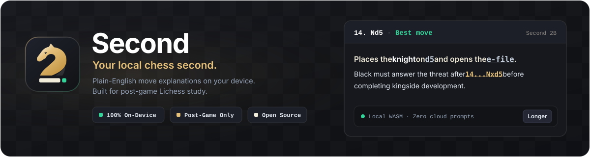

<p align="center">
  
</p>

# Second

**Your local chess second.**

Second is an open-source chess explanation system.
Standard chess engines show numbers and move sequences.
Second explains the ideas behind chess moves in clear language.
The system helps beginners and club players understand their games.
See [`docs/BRAND.md`](docs/BRAND.md) for our brand tokens, SVG marks, and voice guidelines.

## Model

Second is built around **Second-1.0-2B**, based on Qwen 3.5:

- **Second-1.0-2B:** Released on Hugging Face as [joebos/Second-1.0-2B](https://huggingface.co/joebos/Second-1.0-2B) and quantized WebAssembly shards [joebos/Second-1.0-2B-GGUF](https://huggingface.co/joebos/Second-1.0-2B-GGUF).
- **Prompt contract:** Explains moves and positions for `beginner` and `club` levels in `short` and `long` detail.

## Browser Extension

The project includes a Manifest V3 browser extension for Lichess.
The extension runs inside the Chrome side panel.
It runs the language model locally on your device in WebAssembly (`wllama`).
Stockfish also runs locally in WebAssembly.
An optional Lichess Cloud Eval toggle (on by default) checks cached Lichess evaluations before falling back to local Stockfish.
Turn off **Use Lichess Cloud Eval** in Settings to evaluate every position locally.
Prompts and commentary stay on your device.

### Fair-Play Rule

Second protects fair play in online chess.
The extension functions only after a game ends.
If a game is in progress, the extension disables all analysis.
The extension permits analysis only on these pages:
- Completed games.
- Analysis boards (`/analysis`).
- Study pages (`/study`).

When an active game is open, the panel displays:
> "Second is off during live games. Open the game after it ends."

## Current Status (`Second-1.0-2B` v1.0.0 Soft Release)

Phases 0 through 9 are **complete**, and `Second-1.0-2B` is published on Hugging Face:
- **Hard-Fail Rate (All 9 Deterministic Checks)**: `4.67%` (`14 / 300` items, gate $\le 5.0\%$) — [`eval/reports/Second-1.0-2B.md`](eval/reports/Second-1.0-2B.md)
- **In-Band Length Rate**: `99.67%` (`62.0` words mean, gate $\ge 80.0\%$)
- **First-Person Diary Voice Rate**: `0.00%` (down from `51.3%` in Iteration 1)
- **Better-Move Counterfactual Score**: `1.0000` (`100.0%` on bad moves)
- **Debiased Gemini Judge Overall**: `3.96 / 5.0` (up from `2.78` in Iteration 1)
- **Pairwise Win Rate**: `281W–0L` (`100.0%` decisive win rate, `97.5%` LC-WR) vs Iteration 1 `grpo-1.0-2b`, `293W–0L` (`86.2%` LC-WR) vs `base-qwen-2b`, and `202W–20L` (`91.0%` decisive win rate, `74.5%` LC-WR) vs `gemini-flash`.
- **Phase 8 (Browser Export & Quantization)**: Merged, stripped vision tower, quantized to `Q4_K_M` GGUF (`1,204.9 MiB`, `4.00%` post-quantization hard-fail rate on 100 test prompts), and uploaded to [joebos/Second-1.0-2B](https://huggingface.co/joebos/Second-1.0-2B) and [joebos/Second-1.0-2B-GGUF](https://huggingface.co/joebos/Second-1.0-2B-GGUF).
- **Phase 9 (Browser Extension)**: Built and verified in [`extension/`](extension/) (`wllama` WASM inference, local Stockfish WASM, polite Lichess Cloud Eval, fail-closed fair-play lock, and Monograph side panel UI). Run `npm run package` in `extension/` to build `extension/release/second-extension-v1.0.0.zip`.
- **Demo Space**: Gradio demo app in [`demo_space/`](demo_space/) for Hugging Face Spaces ([joebos/second-chess-demo](https://huggingface.co/spaces/joebos/second-chess-demo)).

## Repository Layout

```text
second/
├── LICENSE                  # Apache 2.0 license
├── README.md                # Project documentation
├── PLAN.md                  # Master project plan (Phases 0–12)
├── TRAINING_PLAN.md         # Phase 6.5 capability iteration plan & Stage T0–T6 results
├── docs/                    # Architecture records and specifications
│   ├── brand/               # Brand vectors (logo mark, lockup, banner, social preview)
│   ├── BRAND.md             # Brand identity, Monograph palette, and voice guide
│   ├── decisions/           # Runtime (wllama GGUF), compute, and teacher model records
│   ├── data_sources.md      # Data licensing and pipeline plans
│   └── prompt_format.md     # Input prompt contract (Phase 1)
├── core/                    # Shared fact extractor and prompt builder
│   ├── python/              # Python implementation + tactical motif detectors (Phase 1 / T1)
│   ├── ts/                  # TypeScript implementation with 100% parity (Phase 1 / T1)
│   └── golden/              # 230 parity test positions and generator (Phase 1 / T1)
├── data/                    # Data pipeline and teacher distillation (Phase 2 / T2)
│   ├── sources/             # Data download and extraction scripts
│   ├── pipeline/            # Stockfish analysis, teacher synthesis, filtering, and RL v2 prompts
│   └── cards/               # Dataset documentation cards
├── rewards/                 # Rule checkers, relational/opening claim verifiers, and Reward v2
├── training/                # SFT and GRPO training pipelines (Phases 5–6.5)
│   ├── configs/             # Frozen recipe configs (second-1.0-2b.yaml, sft_v2_*, grpo_v2_*)
│   ├── sft_v2.ipynb         # Stage T3 SFT v2 training notebook
│   ├── grpo_v2.ipynb        # Stage T4 GRPO v2 (DAPO + Reward v2) notebook
│   └── stage_t6_eval.ipynb  # Stage T6 self-contained frozen test-set evaluation notebook
├── eval/                    # Evaluation harness, dev set (150 items), and frozen test set (300 items)
│   ├── devset-1.0.jsonl     # Stratified 150-item development set (Stage T0)
│   ├── testset-1.0.jsonl    # Frozen 300-item evaluation set (Phase 4.1)
│   ├── metrics.py           # Automatic rule, motif, concept-tier, and length metrics
│   ├── judge.py             # Debiased Gemini Flash rubric and swap-consistent pairwise judge
│   ├── lc_winrate.py        # Length-Controlled Win Rate (LC-WR) logistic regression
│   ├── run_eval.py          # Single-command evaluation harness
│   ├── rating_space/        # Human evaluation Gradio Space
│   ├── results/             # Benchmark test results and experiment_ledger.jsonl
│   └── reports/             # Model evaluation reports (grpo-1.0-2b-v2.md, Second-1.0-2B.md)
├── export/                  # LoRA merge and GGUF Q4_K_M browser conversion (Phase 8)
├── extension/               # Lichess Chrome extension (GPLv3) (Phase 9)
│   ├── LICENSE              # GNU General Public License v3.0
│   ├── manifest.json        # Extension Manifest V3 configuration
│   ├── src/                 # Extension source code
│   ├── public/              # Static assets (WASM, Stockfish, icons)
│   ├── store/               # Chrome Web Store copy and promo assets
│   └── TESTING.md           # Extension test checklist
├── spikes/                  # Research prototypes and benchmarks (Phase 0 & Stage T2.1)
└── .github/workflows/       # CI test pipelines (Phase 1)
```

## Development

### Virtual Environment Setup

To create a virtual environment and install the development dependencies:

```bash
python3 -m venv .venv
source .venv/bin/activate
pip install -r requirements-dev.txt
```

### Running Tests

To run the Python tests from the repository root:

```bash
pytest core/python data/sources data/pipeline rewards eval
```

### Evaluation Harness

To run the full Phase 4 evaluation harness on a model checkpoint or pre-generated outputs:

```bash
python -m eval.run_eval --model-path Qwen/Qwen3.5-2B-Instruct --model-name base-qwen-2b
```

If you evaluate offline without a Gemini API key, add `--skip-judge-if-no-key`:

```bash
python -m eval.run_eval --model-path rule-baseline --backend rule-baseline --model-name rule-baseline --skip-judge-if-no-key
```

To run the TypeScript core tests:

```bash
cd core/ts
npm ci
npm test
```

### Data Pipeline

The data pipeline extracts, filters, and formats chess data for training.
To view all available options, run the pipeline CLI entry point from the repository root:

```bash
python -m data.pipeline.run_pipeline --help
```

The pipeline CLI supports these options:
- `--sft-input`: Input JSONL file of human SFT commentary.
- `--rl-input`: Input JSONL file of CC0 Lichess game positions.
- `--output-dir`: Output directory for full splits.
- `--public-dir`: Output directory for public splits.
- `--export-dir`: Output directory for Hugging Face export package.
- `--cache-path`: Path to Stockfish Parquet cache file.
- `--drive-dir`: Google Drive sync directory.
- `--stockfish-path`: Path to Stockfish executable.
- `--depth`: Stockfish search depth.
- `--workers`: Stockfish worker count.
- `--eval-pool-size`: Target number of evaluation pool items.
- `--rl-target-count`: Target number of RL prompts.
- `--seed`: Random seed for deterministic selection.
- `--upload-hf`: Upload public files to Hugging Face Hub.
- `--sync-drive`: Synchronize files to Google Drive.

### Local Data and Credentials

The directories `data/raw/`, `data/processed/`, and `data/cache/` store local data only.
Git ignores these directories.
The project publishes the dataset on Hugging Face.
If you use Hugging Face authentication, store `HF_ACCESS_TOKEN` in a local `.env` file.
Never commit the `.env` file to version control.

## Licenses

This project uses dual licensing:

1. **Root License (Apache License 2.0):**
   The Apache License 2.0 governs all models, training code, datasets, and shared core libraries.
   See [LICENSE](LICENSE) for the full text.

2. **Extension License (GNU General Public License v3.0):**
   The GNU General Public License v3.0 governs all files in the `extension/` directory.
   The extension uses GPLv3 because it bundles the Stockfish chess engine.
   See [extension/LICENSE](extension/LICENSE) for the full text.

## Sponsoring

Second is free, open-source, and privacy-first.
It has no subscription paywalls or user tracking.
To support future GPU training runs and evaluations, [sponsor the project on GitHub](https://github.com/sponsors/kleinebossie).
See [SPONSORS.md](SPONSORS.md) for sponsorship tiers and backer acknowledgments.

