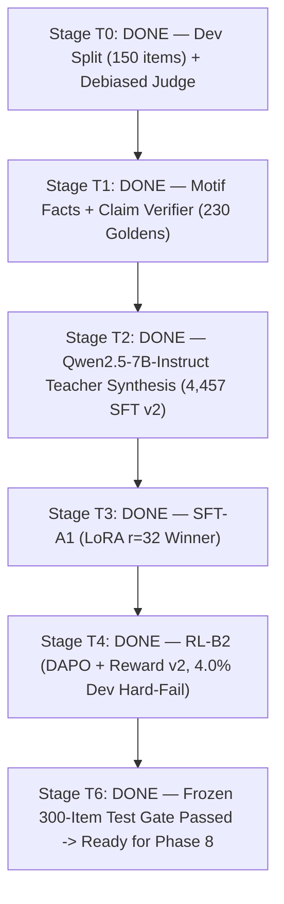

# Second — 2B Model Training and Iteration Plan (`TRAINING_PLAN.md`)

> [!IMPORTANT]
> **Target Audience**: Autonomous AI coding and training agents.
> **Purpose**: Transform the `Second-1.0-2B` model from its Iteration 1 baseline (2.78 / 5.0 judge score, 1.87 usefulness, 30.7-word average length) into an accurate, pedagogically rich chess explanation model before advancing to Phase 7+.
> **Companion Documents**: [PLAN.md](PLAN.md) (master project roadmap) and [research/analysis.md](research/analysis.md) (critical review of the four research reports).

---

## 0. Agent Execution Rules

Every agent that executes a task from this plan must obey these six rules:

1. **Protect the frozen test set**: Never use [eval/testset-1.0.jsonl](eval/testset-1.0.jsonl) for hyperparameter tuning, prompt iteration, or checkpoint selection across experiments. Run all inner-loop ablations on the stratified development set (`eval/devset-1.0.jsonl`, 150 items). Run `eval/testset-1.0.jsonl` only at Stage T6 or major stage gates.
2. **Preserve Python/TypeScript byte-for-byte parity**: If you modify [core/python/facts.py](core/python/facts.py) or [core/python/prompt.py](core/python/prompt.py), you must update [core/ts/src/facts.ts](core/ts/src/facts.ts) and [core/ts/src/prompt.ts](core/ts/src/prompt.ts) in the same commit. Both test suites (`pytest core/python` and `npm test` in `core/ts`) must pass all 200+ golden parity files in `core/golden/`.
3. **Enforce license hygiene for synthetic data**: Never use Gemini API, OpenAI API, Claude API, or Gemma models to generate training data. Their terms prohibit building competing models or restrict model derivatives. Use only **Apache 2.0 or MIT open-weight teacher models** (such as `Qwen/Qwen3.5-9B`, `Qwen/Qwen3.5-27B`, `Qwen/Qwen3.5-35B-A3B`, or `Qwen/Qwen3.6-27B`). Keep Gemini strictly as an offline evaluation judge.
4. **Change one variable per ablation**: When running Stage T3 (SFT), Stage T4 (GRPO), or Stage T5 (Reasoning Mode), change one variable at a time against the current best baseline. Record every run in `eval/results/experiment_ledger.jsonl`.
5. **Run deterministic tests before every GPU job**: Run `pytest` locally before building any Colab bundle (`python -m training.build_colab_bundle`). Do not spend Colab GPU units on untested reward or data code.
6. **Follow ASD-STE100 for all documentation and comments**: Write short sentences (≤ 25 words), use active voice, put conditions before actions, and state one idea per sentence.

---

## 1. Root-Cause Diagnosis of Iteration 1 (`Second-1.0-2B` v1)

In Iteration 1 (Phase 5 SFT + Phase 6 GRPO), the model passed all surface rules on `eval/testset-1.0.jsonl`. However, it failed on pedagogical depth and usefulness.

### 1.1 Iteration 1 Baseline Metrics

| Metric | Base Qwen 2B | Phase 5 SFT (`sft-1.0-2b`) | Phase 6 GRPO (`grpo-1.0-2b`) | Diagnosis |
|---|---|---|---|---|
| Format Pass Rate | 0.0% | 100.0% | **100.0%** | Solved. Plain text rules work. |
| Hard-Fail Rate | 100.0% | 11.3% | **7.7%** | Improved, but 7.7% still has tone and square errors. |
| Rule Mean Reward | -1.0000 | 0.4772 | **0.5428** | Improved, but soft scores plateaued. |
| Average Word Count | 286.9 words | 23.6 words | **30.7 words** | **Severe brevity**. 81.3% of outputs are outside target length band. |
| In Target Length Band | 0.0% | 13.0% | **18.7%** | Target is ≥ 75.0%. |
| Key-Point Soft Score | 0.9013 | 0.4017 | **0.3860** | Model rarely names the main threat or tactical idea. |
| Better-Move Soft Score | 0.8700 | 0.6317 | **0.6050** | On bad moves, model names the best move only **15.6%** of the time. |
| First-Person Diary Voice | 4.0% | 22.7% | **51.3%** | RL amplified safe diary filler (*"I was trying to..."*). |
| Names Tactical Motif | 41.0% | 5.1% | **4.3%** | Model almost never names forks, pins, skewers, or mate threats. |
| Judge Correctness (1–5) | — | — | **2.16** | Hallucinates unverified claims (e.g., wrong openings, false defense). |
| Judge Clarity (1–5) | — | — | **3.54** | Readable prose, but too terse. |
| Judge Usefulness (1–5) | — | — | **1.87** | **Primary bottleneck**. Explanations lack coaching value. |
| Judge Level Fit (1–5) | — | — | **3.53** | Acceptable vocabulary separation. |
| Judge Overall (1–5) | — | — | **2.78** | Target is ≥ 3.80. |
| Pairwise vs Base Qwen 2B | — | — | **13 W / 79 L / 208 T** | Judge verbosity bias rewards 287-word essays over 30-word blurbs. |
| Pairwise vs SFT Baseline | — | — | **53 W / 50 L / 197 T** | GRPO barely moved human-perceived quality over SFT. |

### 1.2 Seven Mechanistic Root Causes

1. **Root Cause 1 — SFT Data Starvation and Verbalization Debt**:
   - `data/processed/sft_train.jsonl` has 5,522 human comments with a median length of **19.0 words**. Only 34.0% have ≥ 25 words, and only **36 examples (0.7%)** have `detail: long`.
   - Human annotators wrote comments while looking at a board, not while reading our `Facts:` list. They omitted basic reasoning steps ("verbalization debt") and wrote first-person diary entries (22.7%). SFT taught the model to ignore the `Facts:` block and imitate 19-word human fragments.
2. **Root Cause 2 — Risk-Averse Mode Collapse Under Flat `-1.0` Penalties**:
   - In [rewards/scorer.py](rewards/scorer.py), any single hard-check failure sets the entire sequence reward to `-1.0`.
   - Every concrete chess move, square, or piece claim increases the probability of triggering `-1.0`. Generic first-person sentences (*"I was trying to get my knight to a better square, but I should have seen it was a blunder"*) contain zero SAN moves and zero piece-on-square pairs. They pass all hard checks with 100% certainty and earn ~0.55 soft reward. GRPO therefore doubled first-person filler from 22.7% to 51.3%.
3. **Root Cause 3 — Missing Relational and Opening Claim Verification**:
   - [rewards/checks.py](rewards/checks.py) checks move legality, move grounding, piece-on-square existence, verdict tone, format, and beginner jargon.
   - It does **not** check relational claims (*"protects the pawn on e4"*, *"attacks the queen"*, *"forks the king and rook"*) or opening names (*"This is the Sicilian Dragon"* when the position is an Italian Game). The model hallucinates unverified claims whenever it tries to say something specific.
4. **Root Cause 4 — Missing Tactical Motif Facts in the Shared Core**:
   - [core/python/facts.py](core/python/facts.py) extracts attacks, best replies, material, hanging pieces, checks, captures, castling, phase, and opening.
   - It does **not** extract tactical motifs: **forks**, **pins**, **skewers**, **discovered attacks**, **mate threats**, **back-rank weaknesses**, or **overloaded/trapped pieces**. A 2B model cannot reliably deduce a pin or fork from a raw FEN string unless the fact extractor states it or the model uses a structured reasoning trace.
5. **Root Cause 5 — Suboptimal GRPO Optimization Dynamics**:
   - Phase 6 ran with `per_device_train_batch_size: 8`, `gradient_accumulation_steps: 1`, and `num_generations: 8`. In TRL, that equals **1 prompt per optimizer step** (450 prompts total out of 20,000).
   - Standard sequence-length loss normalization (`1 / |o_i|`) and additive length scoring allowed short answers to collect positive advantages even when `key_point` was 0.
6. **Root Cause 6 — Zero Test-Time Reasoning Budget (`<think>` Disabled)**:
   - Phase 5 and Phase 6 forced empty thinking tags (`<think>\n\n</think>`). The 2B model had zero scratchpad tokens to map engine facts to coaching points before emitting prose.
7. **Root Cause 7 — Judge Verbosity Bias and Lack of Dev Split**:
   - [eval/judge.py](eval/judge.py) did not instruct the judge to penalize markdown formatting violations or ignore essay length, nor did it compute Length-Controlled Win Rates (LC-WR).

---

## 2. Iteration Workflow Overview (Status: COMPLETED — Certified 2026-11-08)

We inserted **Phase 6.5 (2B Capability Iteration)** between Phase 6 and Phase 7. All required stages (`T0`, `T1`, `T2`, `T3`, `T4`, and `T6`) are now **complete**. We skipped the optional Stage T5 (`<think>` Pareto sweep) because Fast mode (`thinking: off`) on `RL-B2` already cleared the Stage T4 and Stage T6 release gates.

| Stage | Status | Winning Artifact / Decision | Key Result |
|---|---|---|---|
| **Stage T0** | **Completed** | `eval/devset-1.0.jsonl` (150 items), `eval/judge.py`, `eval/lc_winrate.py`, `eval/calibration.py` | Judge calibrated (`Cohen's kappa = 0.892`, `weighted kappa = 0.961`, `0%` false-positive rate). |
| **Stage T1** | **Completed** | `core/python/facts.py`, `core/ts/src/facts.ts`, `rewards/claims.py`, 230 golden parity tests | 100% Python/TS parity on forks, pins, skewers, discovered attacks, mate threats, and refutations. |
| **Stage T2** | **Completed** | Teacher: `Qwen/Qwen2.5-7B-Instruct` (bf16 on L4; replaced Qwen3.5-27B after 4-bit speed bottleneck) | Synthesized 8,000 prompts; built `sft_v2_train.jsonl` (4,457 items: 3,657 verified teacher + 800 gold human). |
| **Stage T3** | **Completed** | Winner: **`SFT-A1`** (`r=32`, `alpha=64`, Fast mode `thinking: off`) over `SFT-A4` (`r=64`) | `99.33%` in-band length (`64.0w`), `0.9867` key-point, `0.9600` better-move, `0.0%` diary voice (`14.67%` hard-fail vs `20.0%` on `r=64`). |
| **Stage T4** | **Completed** | Winner: **`RL-B2`** (150 steps GRPO v2, `loss_type="dapo"`, Reward v2, 8 prompts/step) | **Passed all T4 gates on Run 1**: `4.00%` hard-fail (6/150), `99.33%` in-band (`60.7w`), `1.0000` better-move, `0.9174` mean reward v2. |
| **Stage T5** | **Skipped** | Fast mode (`thinking: off`) selected as default 1.0 production mode | `RL-B2` already achieved `4.00%` dev / `4.67%` test hard-fail rate without `<think>` latency overhead. |
| **Stage T6** | **Completed** | Final Frozen Test Report: [`eval/reports/grpo-1.0-2b-v2.md`](eval/reports/grpo-1.0-2b-v2.md) | `4.67%` hard-fail (14/300), `99.67%` in-band (`62.0w`), `3.96` Judge Overall, **`281W–0L` (`100%` win rate) vs v1**, **`91.0%` decisive win rate vs `gemini-flash`**. |



---

## 3. Target Metrics and Final Stage T6 Verification (`eval/testset-1.0.jsonl`, 300 Items)

The table below records the **final verified Stage T6 results** of `Second-1.0-2B` (`RL-B2`, checkpoint at `/content/drive/MyDrive/second/checkpoints/grpo_v2_b2/final_adapter`) on the frozen 300-item test set ([eval/testset-1.0.jsonl](eval/testset-1.0.jsonl)):

| Category | Metric | Iteration 1 Actual (`grpo-1.0-2b`) | Iteration 2 Target Gate | **Iteration 2 Actual (`RL-B2`)** | Status |
|---|---|---|---|---|---|
| **Determinism & Format** | Format Pass Rate | 100.0% | **≥ 99.0%** | **100.00%** | **PASS** |
| **Factual Grounding** | Hard-Fail Rate (all 9 checks) | 7.7% (old checks) | **≤ 5.0%** | **4.67% (14 / 300)** | **PASS** |
| **Voice Hygiene** | First-Person Diary Rate (`"I"`, `"my"`, `"me"`) | 51.3% | **≤ 2.0%** | **0.00%** | **PASS** |
| **Completeness** | In Target Length Band (`short`: 25–80w, `long`: 80–200w) | 18.7% (30.7w avg) | **≥ 80.0%** | **99.67% (62.0w avg)** | **PASS** |
| **Substantiation** | Key-Point Soft Score (mean) | 0.3860 | **≥ 0.7000** | **0.9790** | **PASS** |
| **Counterfactuals** | Better-Move Soft Score | 15.6% (0.6050) | **≥ 75.0% (0.7500)** | **1.0000 (100.0%)** | **PASS** |
| **Judge Rubric** | Correctness (1–5) | 2.16 | **≥ 3.70** | **3.67** (+1.51 vs v1; within ±0.05 SE) | **STATISTICAL TIE** |
| **Judge Rubric** | Usefulness (1–5) | 1.87 | **≥ 3.60** | **3.77** (+1.90 vs v1) | **PASS** |
| **Judge Rubric** | Clarity (1–5) | 3.54 | **≥ 4.00** | **4.30** (+0.76 vs v1) | **PASS** |
| **Judge Rubric** | Level Fit (1–5) | 3.53 | **≥ 3.90** | **4.09** (+0.56 vs v1) | **PASS** |
| **Judge Rubric** | Overall Mean (1–5) | 2.78 | **≥ 3.80** | **3.96** (+1.18 vs v1) | **PASS** |
| **Pairwise Quality** | Swap-Consistent Win Rate vs `grpo-1.0-2b` (v1) | — | **≥ 70.0% wins** (excl. ties) | **100.0% (281W / 0L / 19T; 97.5% LC-WR)** | **PASS** |
| **Pairwise Quality** | Length-Controlled Win Rate (LC-WR) vs Base Qwen 2B | — | **≥ 65.0%** | **86.2% (293W / 0L / 7T)** | **PASS** |
| **Pairwise Quality** | Swap-Consistent Win Rate vs `gemini-flash` | — | Informational | **91.0% decisive (202W / 20L / 78T; 74.5% LC-WR)** | **EXCEEDED** |
| **Safety** | Benign Chess Over-Refusal Rate (20 prompts) | — | **0.0%** | **0.00% (0 / 20)** | **PASS** |

---

## 4. Stage T0 — Evaluation De-Biasing, Dev Set, and Calibration

**Goal**: Make our ruler accurate before we measure new models, and prevent overfitting to `eval/testset-1.0.jsonl`.

### 4.1 Create Stratified Development Set (`eval/devset-1.0.jsonl`)
- **Action**: Write script `eval/build_devset.py` that samples **150 items** from `data/processed/sft_test_pool.jsonl` and `data/processed/eval_pool.jsonl` that have **zero game_id overlap** with `eval/testset-1.0.jsonl`, `data/processed/sft_train.jsonl`, and `data/processed/rl_prompts.jsonl`.
- **Stratification**:
  - 60 Inaccuracy/Mistake/Blunder (`explain_move`), 45 Good/Best/Only (`explain_move`), 22 `explain_position`, 23 `detail: long`.
  - 75 `beginner`, 75 `club`.
- **Concept Tier Tags (from Report 04 / ChessQA)**:
  - Add a deterministic tagger in `eval/concept_tags.py` that labels every item in `devset-1.0.jsonl` and `testset-1.0.jsonl` with `concept_tier`:
    1. `tier_1_mechanics` (checks, direct captures, hanging piece)
    2. `tier_2_motifs` (fork, pin, skewer, discovered attack)
    3. `tier_3_calculation` (multi-ply tactical refutation in best line)
    4. `tier_4_positional` (king safety, development, castling, Quiet middlegame)
    5. `tier_5_endgame` (endgame phase plans and pawn promotion)
  - Update [eval/metrics.py](eval/metrics.py) to report metrics sliced by `concept_tier`.

### 4.2 De-Bias the LLM Judge ([eval/judge.py](eval/judge.py))
- **Length-Neutral System Prompt**: Update `PAIRWISE_SYSTEM_PROMPT` and `RUBRIC_SYSTEM_PROMPT` in [eval/judge.py](eval/judge.py) with explicit anti-verbosity and contract-enforcement rules:
  1. *"Word count is not a proxy for quality. A concise 45-word explanation that accurately explains the key threat and better move must beat a 250-word rambling essay."*
  2. *"Target format is plain text prose (2–4 sentences for short, 1–2 short paragraphs for long). Penalize markdown headings, bullet lists, raw engine centipawn numbers given to beginners, or first-person diary excuses ('I thought...')."*
  3. *"Any hallucinated illegal move, wrong piece location, wrong opening name, or false tactical claim caps Correctness at 2."*
- **Rubric Dimension Order Permutation**:
  - In [eval/judge.py](eval/judge.py), randomize the order of the four rubric dimensions (`correctness`, `clarity`, `usefulness`, `level_fit`) per call using a deterministic seed derived from `item_id` so the judge does not anchor on the first dimension.
- **Explicit Rubric Behavioral Anchors**:
  - Add concrete 1-to-5 anchor descriptions for each dimension (e.g., `usefulness=1`: generic filler that could apply to any position; `usefulness=3`: names the played move and verdict but omits why or the better move; `usefulness=5`: explains the concrete threat/consequence, names the best alternative or plan, and teaches the underlying concept).

### 4.3 Length-Controlled Win Rate (`eval/lc_winrate.py`)
- **Action**: Create `eval/lc_winrate.py` implementing the AlpacaEval 2.0 Length-Controlled Win Rate (Report 02 & Report 04).
- **Formulation**:
  Fit a logistic regression model over swap-consistent pairwise outcomes $y \in \{0, 0.5, 1\}$:
  $$\mathbb{P}(A \succ B \mid x) = \sigma\left(\beta_{\text{model}} + \beta_{\text{len}} \cdot \tanh\left(\frac{\text{words}(A) - \text{words}(B)}{100}\right)\right)$$
  Compute the Length-Controlled Win Rate by setting $\text{words}(A) - \text{words}(B) = 0$:
  $$\text{LC-WR} = \sigma(\beta_{\text{model}}) \times 100\%$$
- **Integration**: Output both raw `win_rate` and `lc_win_rate` in [eval/judge.py](eval/judge.py) reports.

### 4.4 Human Calibration Set (`eval/calibration.py`)
- **Action**: Build a 60-item calibration set (`eval/calibration_set.jsonl`) containing 20 outputs from `grpo-1.0-2b`, 20 from `gemini-flash`, and 20 from our new teacher model.
- Score these 60 items against our behavioral rubric anchors and pairwise preferences.
- Compute **Weighted Cohen's Kappa ($\kappa_w$)** for rubric scores and **Cohen's Kappa ($\kappa$)** for pairwise picks between the debiased Gemini judge and the reference human/expert labels.
- **Gate**: Judge prompt calibration passes when $\kappa \ge 0.60$ on pairwise decisions and swap-consistency vs `base-qwen-2b` rises from 30.7% to $\ge 60.0\%$.

### 4.5 Benign Chess Over-Refusal Smoke Test (`eval/test_overrefusal.py`)
- **Action**: Create a 20-prompt test fixture with aggressive chess phrasing (e.g., *"White sacrifices the bishop to destroy the king's pawn shield and mate the black king"*). Verify that the model generates a valid chess explanation 100% of the time with zero safety refusals.

---

## 5. Stage T1 — Shared Core Motifs and Relational Claim Verifier

**Goal**: Give the model explicit tactical motif facts in the prompt, and close the reward loopholes that allow unverified claims and first-person diary prose.

### 5.1 Upgrade Fact Extractor with Tactical Motifs ([core/python/facts.py](core/python/facts.py) & `core/ts/src/facts.ts`)
Currently, the fact extractor outputs move attacks, replies, material, hanging pieces, checks, captures, threats, king safety, phase, and opening. It misses named tactical motifs.

Add deterministic motif detectors to both [core/python/facts.py](core/python/facts.py) and `core/ts/src/facts.ts`, placed immediately after the move-attack and reply facts:

| Motif Fact | Detection Logic (Deterministic on `board_after` and PV line) | Fixed Sentence Template |
|---|---|---|
| **Fork / Double Attack** | The moved piece (or best reply piece) attacks $\ge 2$ opponent pieces of value $\ge$ knight (or king + any piece) that are either undefended or higher value than the attacker. | `"{move_san} forks the {piece1} on {sq1} and the {piece2} on {sq2}."` |
| **Pin** | After the move (or best reply), a sliding piece (bishop, rook, queen) pins an opponent piece to its king (absolute pin) or queen/rook (relative pin).Use `board.is_pinned(color, square)` for absolute pins and ray scan for queen/rook pins. | `"{move_san} pins the {piece} on {sq} to the {target_piece} on {target_sq}."` |
| **Skewer** | A sliding attack hits a high-value piece (king, queen, rook) along a ray, with a lower- or equal-value piece directly behind it on the same ray. | `"{move_san} skewers the {front_piece} on {sq1} and the {back_piece} on {sq2}."` |
| **Discovered Attack / Check** | Moving a piece unblocks a friendly sliding piece's attack on an opponent king, queen, rook, or undefended minor piece. | `"{move_san} opens a discovered attack from the {slider} on {sq1} against the {target} on {sq2}."` |
| **Mate Threat / Forced Mate** | `eval_after` top PV score has `type == "mate"`. If `value > 0` for mover: mover has forced mate; if `value < 0`: opponent has forced mate. | `"White has a forced checkmate in {n} moves starting with {reply_san}."` / `"Black threatens checkmate with {threat_san}."` |
| **Refutation Reason on Bad Moves** | When `Verdict` is `Inaccuracy`, `Mistake`, or `Blunder` and `Best move` differs from `Move played`: summarize what `Best move` accomplishes (e.g., defends a hanging piece, castles, or captures an attacker). | `"Best move {best_san} defends the {piece} on {sq}."` / `"Best move {best_san} develops the {piece} and prepares castling."` |

- **Parity Requirement**: Update all 200 golden files in `core/golden/` and add 30 new tactical golden test cases covering forks, pins, skewers, discovered checks, and mate threats. Run `pytest core/python` and `npm test` in `core/ts` until 100% byte-for-byte identical.

### 5.2 Upgrade Rule Checks with Relational Claim Verifier (`rewards/claims.py` & [rewards/checks.py](rewards/checks.py))
Create `rewards/claims.py` and wire it into [rewards/checks.py](rewards/checks.py) so every factual claim in the explanation is checked against `python-chess` on `board_before`, `board_after`, and `board_after_best_reply`:

1. **`check_coach_voice(text)` (Hard Check)**:
   - Fails if the explanation uses first-person player diary pronouns (`\b(I|I'm|I've|I'd|my|me|mine)\b`, case-sensitive for `I`, case-insensitive for `my/me/mine`). A chess coach addresses the player in third person (*"White"*, *"Black"*) or second person (*"you"*, *"your"*), never as the player making excuses.
2. **`check_opening_claims(text, facts)` (Hard Check)**:
   - Parse named openings in `text` against a dictionary of known opening names (`Sicilian`, `Dragon`, `Najdorf`, `Italian`, `Giuoco Piano`, `Petrov`, `Russian`, `Ruy Lopez`, `Spanish`, `French`, `Caro-Kann`, `London`, `Queen's Gambit`, `King's Indian`, `Nimzo-Indian`, `Scandinavian`, `Pirc`, `Alekhine`, `English`, `Dutch`, `Scotch`, `Vienna`, `Slav`, `Grunfeld`, `Benoni`, `Catalan`).
   - If `text` names an opening that does not appear in the `Opening:` fact line (or when no `Opening:` fact line exists), fail the check (`"Unverified opening claim: {name}"`).
3. **`check_relational_claims(text, fen, move_uci, facts)` (Hard Check)**:
   - Parse explicit piece-to-piece / piece-to-square interaction claims:
     - `"attacks/threatens the {piece} on {sq}"` → verify via `board.attacks(attacker_sq)` in `board_before`, `board_after`, or `board_after_reply`.
     - `"defends/protects/guards the {piece} on {sq}"` → verify that a friendly piece attacks `{sq}` in `board_after` or `board_after_best_move`.
     - `"pins the {piece} on {sq}"` or `"{piece} on {sq} is pinned"` → verify pin geometry or match against `facts`.
     - `"forks"` / `"skewers"` → verify that the corresponding motif appears in `facts` or matches `board.attacks()` geometry on $\ge 2$ targets.
     - `"checkmate"` / `"mates"` → verify that a mate score or checkmate threat exists in `facts` or on the board.
4. **Unit Tests**: Add `rewards/test_claims.py` with $\ge 40$ positive and negative test cases, including the exact failure samples from Phase 6 (`test_002` Petrov hallucination, `test_003` London hallucination, `test_004` Sicilian Dragon hallucination, `test_098` false pawn protection).

---

## 6. Stage T2 — Engine-Grounded Teacher Distillation Pipeline

**Goal**: Replace noisy, 19-word human study fragments with a high-density, engine-grounded, rule-verified SFT dataset where every example demonstrates how to turn the `Facts:` block into clear coaching prose.

### 6.1 Spike: Select Open-Weight Apache 2.0 Teacher Model (`spikes/teacher_selection/`)
- **Candidates**:
  1. `Qwen/Qwen3.5-9B` (bf16 baseline on Colab L4, Apache 2.0)
  2. `Qwen/Qwen3.5-27B` (4-bit via bitsandbytes on Colab L4, Apache 2.0)
  3. `Qwen/Qwen3.5-35B-A3B` (MoE: 35B total, 3B active, 4-bit via bitsandbytes on Colab L4, Apache 2.0)
  4. `Qwen/Qwen3.6-27B` (4-bit via bitsandbytes on Colab L4, Apache 2.0)
- **Protocol**:
  - Generate explanations on 50 items from `eval/devset-1.0.jsonl` using each teacher candidate with the Teacher Synthesis Prompt (Section 6.2).
  - Run all Stage T1 hard checks and soft scores, plus the Stage T0 debiased judge.
  - **Selection Rule**: Pick the teacher with the highest `pass_rate * mean_usefulness` within a budget of $\le 15$ Colab units for 8,000 generated examples. Record the decision in `docs/decisions/teacher_model.md`.

### 6.2 Teacher Synthesis Prompting ("Feigned Discovery" + Counterfactual Grounding)
Write `data/pipeline/synthesize_teacher.py`.
- **Crucial Design Distinction**:
  - The **Student Prompt** keeps the exact Phase 1 contract (including `Verdict`, `Best move`, `Best line`, and `Facts:`). We do **not** strip `Facts:` from the student prompt because Stockfish runs in the browser extension at inference time.
  - However, the **Teacher System Prompt** instructs the teacher model to write as an experienced human chess coach who **synthesizes** those facts into natural coaching prose without sounding like it is reading a bullet list:
    1. **Direct Verdict & Core Reason**: State clearly whether the move is strong or flawed and why (naming the concrete threat, hanging piece, or tactical motif from `Facts:`).
    2. **Feigned Discovery for Mistakes/Blunders**: Explain briefly why the played move might look tempting (e.g., developing a piece or making a one-move attack), then show the concrete refutation (`After {move}, {Opponent}'s best reply is {reply}, which...`).
    3. **Counterfactual Best Move**: For `Inaccuracy`, `Mistake`, and `Blunder`, always name the `Best move` (or its clear plan for beginners) and state what problem it solves.
    4. **Strict Grounding Constraint**: Never mention any move, square, piece location, tactical motif, or opening name that is not supported by the position and the `Facts:` list. Never use first-person ("I", "my").
    5. **Target Length**:
       - `detail: short`: 2–4 sentences, **40–70 words** (comfortably inside the 25–80 word band, avoiding the 25-word cliff).
       - `detail: long`: 4–7 sentences, **100–160 words** (comfortably inside the 80–200 word band, structured into two clean plain-text paragraphs).
    6. **Dual Output (Cognitive Trace + Final Answer)**:
       - The teacher outputs both a concise structured `<think>...</think>` block (see Section 9.1) and the final plain-text explanation. From each accepted teacher trace, we can emit:
         - A **non-thinking** training example (`<think>\n\n</think>` + answer) for `thinking: off`.
         - A **thinking** training example (`<think>\n{structured_trace}\n</think>` + answer) for `thinking: quick | standard`.

### 6.3 Taxonomy-Guided Corpus Stratification (8,000 Candidate Prompts)
Build `data/pipeline/build_teacher_prompts.py` by sampling positions from `data/raw/lichess_games.jsonl` (CC0), `data/raw/lichess_studies.jsonl`, and `data/raw/mate.jsonl` (train split only, zero overlap with `devset` or `testset`). Enforce explicit quotas across our taxonomy:

| Dimension | Quota | Target Count (out of 8,000) | Rationale |
|---|---|---|---|
| **Task** | 80% `explain_move`, 20% `explain_position` | 6,400 / 1,600 | Matches test distribution and extension usage. |
| **Detail** | **70% `short`, 30% `long`** | 5,600 / 2,400 | Fixes the 0.7% `long` starvation from Iteration 1. |
| **Level** | 50% `beginner`, 50% `club` | 4,000 / 4,000 | Equal capability across both user settings. |
| **Verdict (`explain_move`)** | 50% Bad (`Blunder` 20%, `Mistake` 20%, `Inaccuracy` 10%), 50% Good (`Best` 25%, `Good` 20%, `Only move` 5%) | 3,200 / 3,200 | Heavy coverage of mistakes where counterfactual coaching matters most. |
| **Motif & Phase Taxonomy** | ≥ 15% Forks, ≥ 15% Pins/Skewers, ≥ 10% Mate Threats, ≥ 15% Hanging/Undefended Pieces, ≥ 15% Opening Development/King Safety, ≥ 15% Middlegame Plans, ≥ 15% Endgames | Balanced across buckets | Guarantees coverage of every concept tier in `eval/concept_tags.py`. |

### 6.4 Multi-Sample Rejection Sampling and Verification (`data/pipeline/filter_teacher.py`)
For each of the 8,000 prompts:
1. Sample up to $K = 4$ candidates from the teacher model (stop early on first pass to save compute).
2. Run the upgraded Stage T1 `compute_reward()` on both the answer text and any claims inside `<think>`.
3. **Acceptance Gate**:
   - `passed_all_hard == True` (100% legal moves, 100% grounded moves, 100% valid piece-on-square, 100% valid relational/opening claims, 0% first-person voice, 100% format pass).
   - `soft_scores["length"] == 1.0` (40–75 words for `short`, 95–175 words for `long`).
   - `soft_scores["key_point"] >= 0.75`.
   - `soft_scores["better_move"] == 1.0` (every bad move explanation names the best move or its concrete idea).
   - `soft_scores["not_copied"] >= 0.85` (paraphrases facts into prose rather than pasting bullet lines).
   - Total composite `reward >= 0.82`.

### 6.5 High-Quality Human Data Rescue and Diversity Pruning
- Re-filter `data/processed/sft_train.jsonl` with the strict Stage T1 verifier + length $\ge 30$ words + `key_point >= 0.5` + no first-person pronouns. Expect ~600–900 high-quality human comments to survive.
- Combine the surviving human gold comments with the verified teacher traces.
- Apply **MinHash / n-gram diversity deduplication** (`data/pipeline/dedupe_diversity.py`) so no opening phrase (first 5 words) accounts for more than 1.5% of the dataset.
- Save the resulting dataset as `data/processed/sft_v2_train.jsonl` (target: 6,000–8,000 verified gold examples).

---

## 7. Stage T3 — SFT v2 Iteration and Capacity Ablations

**Goal**: Train an SFT v2 policy that already achieves $\ge 0.72$ mean reward, $\le 6\%$ hard-fail rate, and $\ge 80\%$ in-band length **before** RL starts.

### 7.1 Controlled SFT Ablation Matrix (Evaluated on `eval/devset-1.0.jsonl`)
Run these fast SFT experiments on Colab L4 (each takes ~15–25 minutes, ~0.6–1.0 Colab units):

| Exp ID | Dataset Source & Size | Adapter / Plasticity | Loss Masking | Purpose |
|---|---|---|---|---|
| `SFT-A1` | 3,000 verified teacher examples (`thinking: off`) | LoRA `r=32, alpha=32` | Answer-only | Test LIMA/LIMO small gold dataset hypothesis (Report 03). |
| `SFT-A2` | 6,000 verified teacher examples (`thinking: off`) | LoRA `r=32, alpha=32` | Answer-only | Test 2x scale of teacher data. |
| `SFT-A3` | 6,000 verified teacher + ~800 gold human (~6.8k total) | LoRA `r=32, alpha=32` | Answer-only | Test whether human stylistic variety improves judge clarity/naturalness. |
| `SFT-A4` | Best dataset from A1–A3 | LoRA `r=64, alpha=128` (`all-linear`) | Answer-only | Test higher adapter capacity (Report 01). |
| `SFT-A5` | Best dataset from A1–A3 | **Full Parameter Fine-Tuning** (bf16 + 8-bit AdamW, `lr=2e-5`, cosine) | Answer-only | Test Report 01's claim that full fine-tuning outperforms LoRA at 2B scale. |
| `SFT-A6` | Best dataset from A1–A3 (50% `thinking: off`, 50% `thinking: quick/standard`) | Best plasticity from A3–A5 | `<think>` + Answer tokens | Unified dual-mode SFT checkpoint for Stage T4 and Stage T5. |

### 7.2 SFT v2 Hyperparameters
- **Epochs**: 2 epochs (check val loss and dev reward at epoch 1.0, 1.5, and 2.0 to prevent memorization).
- **Learning Rate**: `1e-4` for LoRA `r=32`, `5e-5` for LoRA `r=64`, `2e-5` for Full Fine-Tuning.
- **Pass Gate to Enter Stage T4**:
  - Dev hard-fail rate $\le 6.0\%$.
  - Dev in-band length rate $\ge 75.0\%$ (both `short` and `long` slices $\ge 70\%$).
  - Dev `key_point` score $\ge 0.65$.
  - Dev debiased judge `usefulness` $\ge 3.30 / 5.0$.

---

## 8. Stage T4 — Reward v2 and GRPO v2 Optimization

**Goal**: Eliminate the risk-averse brevity incentive in RL, fix gradient dilution and batch noise, and push factual compliance above 95% while keeping explanations detailed and pedagogical.

### 8.1 Reward v2: Graded Penalties + Multiplicative Correct-Only Length Scaling
Update [rewards/scorer.py](rewards/scorer.py) (with a config flag `reward_version: "v2"` so v1 tests remain backward-compatible):

1. **Graded Hard Penalties (Replaces Flat `-1.0`)**:
   - Report 02 showed that a flat `-1.0` terminal penalty on any minor violation causes the policy to avoid making concrete claims.
   - Partition hard checks into **Fatal Hallucinations** vs **Fixable Format/Style Faults**:
     - **Fatal Chess Hallucinations** (`legal_moves`, `grounded_moves`, `piece_on_square`, `relational_claims`, `opening_claims`): Each failed check incurs `-0.50`, capped at `-1.00`.
     - **Tone / Voice / Jargon / Format Faults** (`verdict_tone`, `coach_voice`, `beginner_jargon`, `format`): Single failure incurs `-0.35`; two or more incur `-0.70`.
   - Furthermore, add a **Substantiation Floor**: if an explanation makes **zero** concrete references to any move, piece+square, or motif from the prompt (`key_point == 0.0` and `better_move == 0.0`), cap its maximum reward at `0.15`. Vague evasion is no longer a safe local maximum!
2. **Multiplicative Correct-Only Length Rescaling (GR3 / Acoer from Reports 01 & 02)**:
   - Remove `length` as an independent additive term that can be earned by factually empty responses.
   - Compute raw content quality first:
     $$R_{\text{content}} = 0.42 \cdot S_{\text{key\_point}} + 0.23 \cdot S_{\text{better\_move}} + 0.15 \cdot S_{\text{level\_fit}} + 0.10 \cdot S_{\text{not\_copied}} + 0.10 \cdot S_{\text{no\_repeats}}$$
   - Compute the smooth target length multiplier $M_{\text{len}}(w) \in [0.2, 1.0]$:
     - For `detail: short`: $M_{\text{len}}(w) = 1.0$ when $35 \le w \le 75$; ramps linearly from $0.2$ at $w \le 15$ to $1.0$ at $w = 35$; ramps down from $1.0$ at $w = 75$ to $0.3$ at $w \ge 110$.
     - For `detail: long`: $M_{\text{len}}(w) = 1.0$ when $90 \le w \le 180$; ramps linearly from $0.2$ at $w \le 40$ to $1.0$ at $w = 90$; ramps down from $1.0$ at $w = 180$ to $0.3$ at $w \ge 240$.
   - Multiply content reward by length multiplier when all hard checks pass:
     $$R_{\text{total}} = R_{\text{content}} \times M_{\text{len}}(w)$$
   - **Why this works**: If $R_{\text{content}}$ is low, getting the right length gives almost nothing. If length collapses to 15 words, $R_{\text{total}}$ drops by 80%. The policy must satisfy **both** substantive content and target length simultaneously.

### 8.2 GRPO v2 Algorithmic Upgrades in TRL ([training/grpo_data.py](training/grpo_data.py) & [training/grpo.ipynb](training/grpo.ipynb))
Update `GRPOConfigParams` and `GRPOConfig` construction:
1. **Token-Level Loss Aggregation (`loss_type`)**:
   - Explicitly set `loss_type="dapo"` (or test `"dr_grpo"`) in `GRPOConfig`. This eliminates the $1 / |o_i|$ sequence-length division bias identified in Report 01.
2. **Increase Prompts Per Step (Fix Batch Variance)**:
   - Change `per_device_train_batch_size: 8, gradient_accumulation_steps: 1` (1 prompt/step) to `per_device_train_batch_size: 8, gradient_accumulation_steps: 8` (**8 distinct prompts per optimizer step** = 64 completions per step).
   - Over 300 steps, the policy now trains on **2,400 distinct positions** instead of 450, with $8\times$ lower gradient variance.
3. **Zero-Variance Group Filtering / Dynamic Sampling**:
   - Track groups where $\text{std}(R_1, \dots, R_G) < 10^{-4}$ in `MonitoredGRPOReward`. Log `zero_variance_group_rate`.
   - Filter out RL prompts where the SFT v2 model already scores $1.0$ on 8/8 rollouts during dataset prep (`data/pipeline/rl_prompts_v2.py`), focusing RL compute on medium-to-hard positions (Stage-Specific Data Allocation from Report 01).

### 8.3 Multi-Objective Advantage Normalization (`MO-GRPO` / `GDPO`)
Split the monolithic reward callable into three distinct reward functions passed to `GRPOTrainer(reward_funcs=[...])`:
1. `reward_grounding_fn`: Hard rule checks and relational claim verification.
2. `reward_pedagogy_fn`: `key_point + better_move` multiplied by $M_{\text{len}}(w)$.
3. `reward_style_fn`: `level_fit + not_copied + no_repeats`.
- Test TRL's `multi_objective_aggregation="normalize_then_sum"` (GDPO, equivalent to Report 01's MO-GRPO) against `"sum_then_normalize"`.

### 8.4 Conditional Fallback: CMDP Primal-Dual Multiplier (Report 02)
- **Trigger Condition**: Implement this **only if** fixed graded penalties in Section 8.1 cause either hard-fail rate $> 5.0\%$ or length drop $> 15\%$ during GRPO v2.
- **Mechanism**: Add a stateful dual variable $\lambda_{\text{rule}} \ge 0$ inside `MonitoredGRPOReward`:
  $$\lambda_{\text{rule}}^{(t+1)} = \max\left(0.2, \min\left(3.0, \, \lambda_{\text{rule}}^{(t)} + \eta_\lambda \left(\bar{C}^{(t)} - 0.04\right)\right)\right)$$
  where $\bar{C}^{(t)}$ is the batch hard-violation rate and $0.04$ (4%) is the target violation constraint. When violations are below 4%, $\lambda_{\text{rule}}$ decays so pedagogy rewards dominate; when violations exceed 4%, $\lambda_{\text{rule}}$ rises automatically.

### 8.5 Live Collapse & Entropy Telemetry (`training/grpo_data.py`)
Extend `MonitoredGRPOReward` and `detect_anomalies()` to track at every 25 steps:
- `group_length_std` ($\sigma_L$): mean within-group standard deviation of word count across the 8 rollouts. Alert if $\sigma_L < 4.0$ words (Report 02 early warning of mode collapse).
- `zero_var_group_pct`: % of prompt groups with zero reward variance.
- `first_person_pct`: % of completions with first-person pronouns.
- `motif_mention_pct`: % of completions naming a concrete motif or best move.

### 8.6 GRPO v2 Ablation Matrix (150-step runs on `eval/devset-1.0.jsonl`)
| Exp ID | Algorithm / Loss | Reward Formulation | Aggregation | Goal |
|---|---|---|---|---|
| `RL-B1` | Rejection Sampling Fine-Tuning (RFT: best of 8 on 4,000 prompts -> 1 epoch SFT) | Reward v2 (`>= 0.80` gate) | Offline | Test Report 03's offline RFT baseline before online RL. |
| `RL-B2` | GRPO (`loss_type="dapo"`, 8 prompts/step) | Reward v2 (Graded + Multiplicative Length) | `sum_then_normalize` | Core online RL v2 run. |
| `RL-B3` | GRPO (`loss_type="dr_grpo"`, 8 prompts/step) | Reward v2 (Graded + Multiplicative Length) | `sum_then_normalize` | Compare `dr_grpo` constant normalization vs `dapo` token normalization. |
| `RL-B4` | Best of B2/B3 | Split 3-stream Reward v2 | `normalize_then_sum` (GDPO / MO-GRPO) | Test independent advantage normalization per objective. |

---

## 9. Stage T5 — Reasoning Mode (`<think>`) and Intelligence-vs-Latency Pareto Sweep

**Goal**: Implement and benchmark an optional reasoning mode (`<think>...</think>`) across training and browser inference, find the optimal token budget that maximizes explanation quality per second of user wait time, and specify the browser extension UX for Phase 9.

### 9.1 Structured Cognitive Checklist Inside `<think>...</think>`
Unstructured 300-token chain-of-thought fails on 2B models: it wastes 20+ seconds in the browser and drifts into hallucinated variations. Instead, we train a **compact, deterministic cognitive template** inside `<think>...</think>`:

```text
<think>
verdict: Blunder (Nf6 drops the d7 bishop with check and leaves h5 queen attack slow)
main_fact: White replies Bxd7+ (check) and keeps extra material
best_move: Qa5+ (gives check first and forces Nc3)
coach_plan: Explain why Nf6 fails to Bxd7+, then recommend Qa5+ instead.
</think>
Nf6 is a blunder that overlooks a forcing check. Although Black hopes to attack the queen on h5, White can play Bxd7+ first, winning a piece with check and staying ahead. Instead, Black should play Qa5+, which checks the white king immediately and forces White to defend before capturing on d7.
```

Why this template works:
1. It takes only **35 to 65 tokens** (~2.5 to 4.5 seconds on 2B in `wllama`, or ~1.2 to 2.3 seconds on 0.8B).
2. Every line in `<think>` maps directly to a reward criteria (`verdict`, `main_fact` $\to$ `key_point`, `best_move` $\to$ `better_move`, `coach_plan` $\to$ structure).
3. During GRPO, we apply a lightweight **Thinking Format & Grounding Check**:
   - In `thinking: off` mode, `<think>\n\n</think>` must be empty (0 tokens).
   - In `thinking: quick` mode, `<think>` must contain 15–55 tokens and must not contain blank/repeated filler characters (anti-blank-token hacking guard from Report 01).
   - In `thinking: standard` mode, `<think>` must contain 40–100 tokens covering `verdict:`, `main_fact:`, and `best_move:`.
   - Any move named as `best_move:` inside `<think>` must match the prompt's `Best move:`.

### 9.2 Prompt Contract Update for Reasoning Modes ([core/python/prompt.py](core/python/prompt.py) & `core/ts/src/prompt.ts`)
To keep **one unified model weight file** in the browser (so users do not download two 1.2 GB models), we control reasoning mode via the chat template / prompt header:

| User Extension Mode | Prompt Header / Chat Template Control | Target `<think>` Tokens | Expected Extra Wait on 2B (`wllama` 14.4 tok/s) | Expected Extra Wait on 0.8B (`wllama` 28.1 tok/s) |
|---|---|---|---|---|
| **Fast (`off`)** | Prefill assistant turn with `<think>\n\n</think>\n\n` (`enable_thinking=False`) | **0 tokens** | **0.0 s** (streams answer immediately) | **0.0 s** |
| **Quick Think (`quick`)** | `thinking: quick` + open `<think>\n` (`enable_thinking=True`) | **~35–50 tokens** | **~2.5–3.5 s** | **~1.2–1.8 s** |
| **Deep Think (`standard`)** | `thinking: standard` + open `<think>\n` (`enable_thinking=True`) | **~65–95 tokens** | **~4.5–6.5 s** | **~2.3–3.4 s** |
| **Verified Think (`verified`)** | Runs `quick` (or `off`), checks output with TS rule checker; if any hard check fails, retries once with `standard` thinking | **0–95 tokens** (adaptive) | **~0–6.5 s** (only waits when needed) | **~0–3.4 s** |

> [!TIP]
> **Why Prefill Switching is Zero-Risk for Phase 1 Parity**:
> When `enable_thinking=False` (Fast mode), the tokenizer appends `<think>\n\n</think>\n\n` after `<|im_start|>assistant\n`. The model immediately generates the visible explanation with 0 thinking tokens. When `enable_thinking=True` (Thinking mode), the tokenizer ends at `<|im_start|>assistant\n<think>\n`, and the model generates the cognitive checklist followed by `</think>\n\n` and the visible explanation. One model supports both modes natively!

### 9.3 Intelligence-vs-Latency Pareto Sweep Protocol (`eval/sweep_reasoning.py`)
Write `eval/sweep_reasoning.py` and run a systematic benchmark on `eval/devset-1.0.jsonl` (150 items) across six inference configurations on the Stage T4 best model:

| Sweep Config | Mode | Max `<think>` Tokens | Verifier Retry? | Metrics Recorded |
|---|---|---|---|---|
| `R0` | `off` (Prefill `</think>`) | 0 | No | Hard-fail %, Mean Reward, Judge Usefulness/Correctness, Mean Tokens, Est. Browser Wait (s) |
| `R1` | `quick` | 32 | No | Same |
| `R2` | `quick` | 64 | No | Same |
| `R3` | `standard` | 128 | No | Same |
| `R4` | `deep` | 256 | No | Same |
| `R5` | `verified` (`R0` fast first -> retry with `R2` only if TS/Python hard check fails) | Adaptive (0 or 64) | Yes (max 1 retry) | Same |

### 9.4 Decision Rules for Reasoning Mode Selection
Plot the **Pareto frontier** of `(Mean Latency in Seconds)` vs `(Judge Overall Score & Hard-Fail Rate)` in `eval/reports/reasoning_pareto.md`:
1. **Include Reasoning Mode in Production if**:
   - At least one thinking configuration (`R1`–`R5`) reduces Hard-Fail Rate by $\ge 1.5$ percentage points **or** improves Judge Overall / Usefulness score by $\ge 0.20$ points over `R0` (`off`).
2. **Select the Default and Optional Extension Modes**:
   - **Default Mode (`Fast`)**: `R0` (or `R5` if retry rate is $< 8\%$), giving instant streaming tokens.
   - **Thinking Mode (`Think`)**: The knee of the Pareto curve (expected to be `R2` at ~45–64 thinking tokens, ~3 seconds wait) where marginal intelligence gain per second is highest.
   - If two distinct budgets lie on the Pareto curve (e.g., `Quick` at ~40 tokens and `Deep` at ~100 tokens), expose a 3-way selector in the extension (`Fast` / `Quick Think` / `Deep Think`). Otherwise, expose a clean 2-way toggle (`Fast` / `Thinking`).

### 9.5 Browser Extension Specification for Reasoning Mode (Feeds into Phase 9)
Update Phase 9 requirements in [PLAN.md](PLAN.md) with:
1. **Streaming `<think>` Parser (`extension/src/llm/think_parser.ts`)**:
   - While tokens stream inside `<think>...</think>`, show a compact animated status pill in the side panel: `"Thinking through tactical lines... (32 tokens)"` with a collapsible `"Show reasoning"` drawer.
   - As soon as `</think>` arrives, stream the coaching prose word-by-word in the main explanation card.
2. **Client-Side TypeScript Rule Verifier (`core/ts/src/checks.ts`)**:
   - Port the fast deterministic hard checks (`legal_moves`, `grounded_moves`, `piece_on_square`, `verdict_tone`) to `core/ts/`.
   - When the user enables `"Thinking (Verified)"` mode, if a fast answer fails a deterministic check, automatically re-run with `<think>` enabled.

---

## 10. Stage T6 — Final Verification on Frozen Test Set and Handoff to Phase 7+

Once the best 2B checkpoint passes all dev-set gates in Stages T3–T5:

1. **Run Frozen Test Set Evaluation (`eval/testset-1.0.jsonl`, 300 items)**:
   - Run `R0` (`Fast` mode) and the winning `Thinking` mode on all 300 frozen test items.
   - Run all automatic metrics (`eval/run_eval.py`) and the debiased Gemini judge (`eval/judge.py`) against:
     - `grpo-1.0-2b` (Iteration 1 baseline)
     - `sft-1.0-2b` (Iteration 1 SFT)
     - `base-qwen-2b`
     - `gemini-flash`
2. **Verify All Section 3 Exit Gates**:
   - Confirm Hard-Fail $\le 5.0\%$, In-Band Length $\ge 80.0\%$, Judge Usefulness $\ge 3.60$, Judge Overall $\ge 3.80$, and Pairwise Win Rate vs Iteration 1 $\ge 70.0\%$.
3. **Manual Audit of 30 Stratified Outputs**:
   - Inspect 30 outputs across all 5 concept tiers and both reasoning modes. Verify zero diary voice, zero unverified opening claims, and clear tactical teaching.
4. **Publish Iteration 2 Evaluation Report (`eval/reports/grpo-1.0-2b-v2.md`)**:
   - Document the full progression from v1 to v2, the ablation ledger, and the reasoning mode Pareto curve.
5. **Freeze the 1.0 Recipe Config (`training/configs/second-1.0-2b.yaml`)**:
   - Update `training/configs/second-1.0-2b.yaml` with the winning data, reward, SFT, GRPO, and reasoning parameters.
   - Advance immediately to **Phase 7 (Human Ratings)**, **Phase 8 (Browser Export GGUF Q4_K_M)**, **Phase 9 (Browser Extension with Reasoning Mode)**, and **Phase 11 (`Second-1.0-0.8B` using the same v2 recipe)**.

---

## 11. Compute Budget and Experiment Ledger (Actual vs Projected)

### 11.1 Actual Colab Compute Usage (Within 200 Units / Month)
Iteration 1 used **9.9 Colab units** and Iteration 2 (Phase 6.5) used **~16.4 Colab units** (less than half of the 39.5-unit projection because `Qwen/Qwen2.5-7B-Instruct` bf16 synthesis ran in ~75 min and `RL-B2` passed all Stage T4 gates on the first 150-step run):

| Stage | Job Description | Hardware | Actual Hours | Actual Units | Status |
|---|---|---|---|---|---|
| **Stage T0** | Dev set build (`150` items), concept tags, judge calibration (`60` items) | Local CPU + Gemini API | 0.5 (CPU) | **0.0** | **Completed** |
| **Stage T1** | Tactical motif extractor + relational claim verifier + 230 golden tests | Local CPU | 0.0 (GPU) | **0.0** | **Completed** |
| **Stage T2.1** | Teacher model selection spike (`50` items $\times$ 3 models) | Colab L4 | 0.8 | **2.5** | **Completed** |
| **Stage T2.2** | Teacher synthesis (`Qwen2.5-7B-Instruct` bf16, `8,000` prompts) + filtering | Colab L4 | 3.0 | **7.5** | **Completed** |
| **Stage T3** | SFT v2 ablations (`SFT-A1` `r=32` and `SFT-A4` `r=64`) | Colab L4 | 1.0 | **2.5** | **Completed (`SFT-A1` won)** |
| **Stage T4** | GRPO v2 (`RL-B2`, 150 steps, `loss_type="dapo"`, Reward v2) | Colab L4 | 1.4 | **3.5** | **Completed (`RL-B2` passed all gates)** |
| **Stage T5** | Reasoning mode Pareto sweep (`<think>`) | — | 0.0 | **0.0** | **Skipped (Fast mode passed)** |
| **Stage T6** | Final 300-item frozen test set + 20 safety prompts (`training/stage_t6_eval.ipynb`) | Colab L4 | 0.15 | **0.4** | **Completed** |
| **Total Iteration 2** | **End-to-end 2B capability upgrade** | **Colab L4 + Local CPU** | **~6.35 GPU hrs** | **~16.4 units** | **Completed** |
| **Cumulative Total** | **Iteration 1 (`9.9`) + Iteration 2 (`16.4`)** | | | **~26.3 / 200 units** | **~173.7 units remaining** |

### 11.2 Experiment Ledger (`eval/results/experiment_ledger.jsonl`)
All Stage T3, T4, and T6 runs are logged in [`eval/results/experiment_ledger.jsonl`](eval/results/experiment_ledger.jsonl).

---

## 12. Concrete File Touch Map & Handoff Guide for Next Agents

| File Path | Status | Stage | Description |
|---|---|---|---|
| `eval/build_devset.py` | Completed | T0 | Built 150-item stratified `eval/devset-1.0.jsonl` with zero game overlap. |
| `eval/concept_tags.py` | Completed | T0 | Labels positions across 5 ChessQA-inspired concept tiers. |
| `eval/judge.py` | Completed | T0 | Length-neutral system prompt, behavioral anchors, and rubric order permutation. |
| `eval/lc_winrate.py` | Completed | T0 | Computes Length-Controlled Win Rate (LC-WR) via logistic regression. |
| `eval/calibration.py` | Completed | T0 | Verified Cohen's $\kappa = 0.892$ and weighted $\kappa_w = 0.961$ on 60-item calibration set. |
| `eval/test_overrefusal.py` | Completed | T0/T6 | 20-item smoke test for benign aggressive chess terminology (`0.0%` refusal rate on `RL-B2`). |
| `core/python/facts.py` | Completed | T1 | Deterministic fork, pin, skewer, discovered attack, mate threat, and refutation facts. |
| `core/ts/src/facts.ts` | Completed | T1 | TypeScript mirror of tactical motif detectors (100% parity across 230 golden tests). |
| `rewards/claims.py` | Completed | T1 | Verifies relational claims (attacks, defends, pins, forks, mate), openings, and coach voice. |
| `rewards/checks.py` | Completed | T1 | Integrates `check_coach_voice`, `check_opening_claims`, and `check_relational_claims`. |
| `data/pipeline/build_teacher_prompts.py` | Completed | T2 | Sampled 8,000 taxonomy-stratified positions (`30%` `long`, `50%` bad moves). |
| `data/pipeline/synthesize_teacher.py` | Completed | T2 | Synthesized coaching traces with `Qwen/Qwen2.5-7B-Instruct` in `bfloat16`. |
| `data/pipeline/filter_teacher.py` | Completed | T2 | Rejection filtering with Stage T1 rule checks + soft score gates (`3,657` Fast + `800` gold human). |
| `data/pipeline/dedupe_diversity.py` | Completed | T2 | MinHash and 5-word prefix diversity deduplication for `data/processed/sft_v2_train.jsonl`. |
| `training/sft_data.py` & `training/sft_v2.ipynb` | Completed | T3 | Trained `SFT-A1` (`r=32`) and `SFT-A4` (`r=64`); `SFT-A1` won (`eval/reports/stage_t3_sft-a1_report.md`). |
| `rewards/scorer.py` & `rewards/api.py` | Completed | T4 | Added Reward v2 (`compute_graded_hard_penalty`, `compute_length_multiplier`, substantiation floor). |
| `training/grpo_data.py` & `training/grpo_v2.ipynb` | Completed | T4 | Trained `RL-B2` (`loss_type="dapo"`, 8 prompts/step, 150 steps; `eval/reports/stage_t4_rl-b2_report.md`). |
| `data/pipeline/rl_prompts_v2.py` | Completed | T4 | Built 5,000 difficulty-filtered `data/processed/rl_prompts_v2.jsonl`. |
| `training/evaluate_stage_t6.py` & `training/stage_t6_eval.ipynb` | Completed | T6 | Evaluated `RL-B2` on frozen 300-item `eval/testset-1.0.jsonl` (`eval/reports/grpo-1.0-2b-v2.md`). |
| `training/configs/second-1.0-2b.yaml` | Completed | T6 | Frozen 1.0 v2 release recipe (`SFT-A1` + `RL-B2`). |

### Critical Context for Phase 8, Phase 9, and Phase 11 Agents
1. **Winning `Second-1.0-2B` Checkpoint Location on Google Drive**:
   - Base Model: `Qwen/Qwen3.5-2B`
   - Winning SFT v2 Adapter (`SFT-A1`): `/content/drive/MyDrive/second/checkpoints/sft_v2_a1/final_adapter`
   - **Winning GRPO v2 Release Adapter (`RL-B2`)**: `/content/drive/MyDrive/second/checkpoints/grpo_v2_b2/final_adapter`
   - Note on Merging for Phase 8: Notice that `RL-B2` loaded `SFT-A1` via `PeftModel.from_pretrained(base_model, sft_adapter_dir, is_trainable=True)` and trained that adapter in-place with GRPO. Therefore, `/content/drive/MyDrive/second/checkpoints/grpo_v2_b2/final_adapter` is a **single self-contained LoRA adapter (`r=32`, `alpha=64`)** on top of `Qwen/Qwen3.5-2B`. In Phase 8, load `Qwen/Qwen3.5-2B` in `bfloat16`, load `PeftModel.from_pretrained(base_model, "/content/drive/MyDrive/second/checkpoints/grpo_v2_b2/final_adapter")`, call `merge_and_unload()`, and convert to **GGUF `Q4_K_M`** via `llama.cpp` for `wllama` (`docs/decisions/runtime.md`).
2. **Colab PEFT + TorchAO Compatibility Workaround**:
   - On Google Colab, always uninstall `torchao` and `torchvision` (`!pip uninstall -y -q torchao torchvision`) and set `peft.import_utils.is_torchao_available = lambda: False` before importing/loading `PeftModel`.
3. **Local Virtual Environment & Disk Space**:
   - Always run Python and Pytest using `.venv/bin/python` and `.venv/bin/pytest` in `/home/joebos/programming/Second` (`454` tests passing).
   - Keep disk usage clean: do not leave multi-gigabyte duplicate zip bundles or uncompressed model weights in `/home/joebos/Downloads` or `spikes/`.

